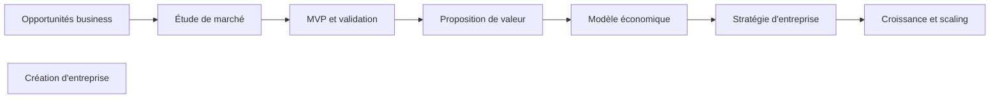

> [!moc] 01 · Entrepreneuriat
> **Mission** — Créer, structurer et faire grandir des entreprises.
> **Périmètre** — création de business, modèles économiques, stratégies, opportunités.

Retour : [[Accueil]] · [[Tableau de bord]]

## Cartographie du domaine
*Clique sur un nœud pour ouvrir la note. Les flèches suivent le chemin logique « vient de → mène à ».*



## Concepts fondamentaux
- [[Opportunités business]]
- [[Étude de marché]]
- [[MVP et validation]]
- [[Proposition de valeur]]
- [[Modèle économique]]
- [[Stratégie d'entreprise]]
- [[Croissance et scaling]]
- [[Création d'entreprise]]
- *Nouveau concept ? Crée-le avec le modèle « Concept » et relie-le ici.*

## Ponts vers les autres domaines
- **[[Marketing digital]]** — [[Croissance et scaling]] ↔ [[Acquisition]] · [[Proposition de valeur]] ↔ [[Copywriting]] · [[Proposition de valeur]] ↔ [[Persona client]] · [[Étude de marché]] ↔ [[Persona client]]
- **[[E-commerce]]** — [[MVP et validation]] ↔ [[Shopify]] · [[Opportunités business]] ↔ [[Recherche de produits]] · [[Étude de marché]] ↔ [[Recherche de produits]]
- **[[Intelligence artificielle]]** — [[Croissance et scaling]] ↔ [[Automatisation]] · [[Croissance et scaling]] ↔ [[IA appliquée au business]] · [[Stratégie d'entreprise]] ↔ [[IA appliquée au business]]
- **[[Finances]]** — [[Croissance et scaling]] ↔ [[Trésorerie]] · [[Création d'entreprise]] ↔ [[Comptabilité]] · [[Modèle économique]] ↔ [[Chiffre d'affaires]] · [[Modèle économique]] ↔ [[Rentabilité]]
- **[[Branding]]** — [[Proposition de valeur]] ↔ [[Positionnement]] · [[Étude de marché]] ↔ [[Positionnement]]
- **[[Développement personnel]]** — [[Stratégie d'entreprise]] ↔ [[Objectifs]]
- **[[Technologie]]** — [[MVP et validation]] ↔ [[No-code]]

## Mes notes dans ce domaine
*Idées, stratégies, apprentissages, lectures et projets qui citent ce domaine ou portent le tag `#domaine/entrepreneuriat`.*

```base
filters:
  and:
    - or:
        - file.hasLink(this.file)
        - file.hasTag("domaine/entrepreneuriat")
    - not:
        - file.inFolder("90 Système")
views:
  - type: table
    name: Mes notes liées
    filters:
      and:
        - 'type != "concept"'
        - 'type != "moc"'
    groupBy:
      property: type
      direction: ASC
    order:
      - file.name
      - type
      - statut
      - maj
    sort:
      - property: file.mtime
        direction: DESC
  - type: table
    name: Concepts du domaine
    filters:
      and:
        - 'type == "concept"'
    order:
      - file.name
      - tags
      - maj
    sort:
      - property: file.name
        direction: ASC
```

## Questions directrices
*Les grandes questions que je veux résoudre dans ce domaine.*
-
