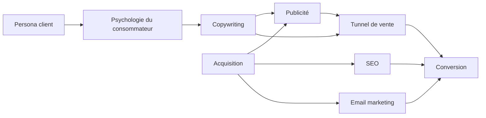

> [!moc] 02 · Marketing digital
> **Mission** — Attirer, convaincre et convertir des clients.
> **Périmètre** — acquisition, publicité, copywriting, tunnels de vente, psychologie du consommateur.

Retour : [[Accueil]] · [[Tableau de bord]]

## Cartographie du domaine
*Clique sur un nœud pour ouvrir la note. Les flèches suivent le chemin logique « vient de → mène à ».*



## Concepts fondamentaux
- [[Persona client]]
- [[Psychologie du consommateur]]
- [[Copywriting]]
- [[Acquisition]]
- [[Publicité]]
- [[SEO]]
- [[Email marketing]]
- [[Tunnel de vente]]
- [[Conversion]]
- *Nouveau concept ? Crée-le avec le modèle « Concept » et relie-le ici.*

## Ponts vers les autres domaines
- **[[Entrepreneuriat]]** — [[Acquisition]] ↔ [[Croissance et scaling]] · [[Copywriting]] ↔ [[Proposition de valeur]] · [[Persona client]] ↔ [[Proposition de valeur]] · [[Persona client]] ↔ [[Étude de marché]]
- **[[E-commerce]]** — [[Conversion]] ↔ [[Expérience client]] · [[Conversion]] ↔ [[Optimisation de boutique]] · [[Copywriting]] ↔ [[Fiche produit]] · [[Email marketing]] ↔ [[Fidélisation client]]
- **[[Intelligence artificielle]]** — [[Copywriting]] ↔ [[ChatGPT]] · [[Copywriting]] ↔ [[Prompt engineering]] · [[Email marketing]] ↔ [[Automatisation]]
- **[[Finances]]** — [[Conversion]] ↔ [[Chiffre d'affaires]] · [[Publicité]] ↔ [[Gestion de budget]]
- **[[Branding]]** — [[Copywriting]] ↔ [[Storytelling]] · [[Copywriting]] ↔ [[Ton de marque]] · [[Persona client]] ↔ [[Positionnement]] · [[Psychologie du consommateur]] ↔ [[Storytelling]]
- **[[Création de contenu]]** — [[Acquisition]] ↔ [[Instagram]] · [[Acquisition]] ↔ [[Stratégie de contenu]] · [[Acquisition]] ↔ [[TikTok]] · [[Acquisition]] ↔ [[YouTube]]
- **[[Technologie]]** — [[SEO]] ↔ [[Création de sites internet]] · [[Tunnel de vente]] ↔ [[Création de sites internet]]

## Mes notes dans ce domaine
*Idées, stratégies, apprentissages, lectures et projets qui citent ce domaine ou portent le tag `#domaine/marketing`.*

```base
filters:
  and:
    - or:
        - file.hasLink(this.file)
        - file.hasTag("domaine/marketing")
    - not:
        - file.inFolder("90 Système")
views:
  - type: table
    name: Mes notes liées
    filters:
      and:
        - 'type != "concept"'
        - 'type != "moc"'
    groupBy:
      property: type
      direction: ASC
    order:
      - file.name
      - type
      - statut
      - maj
    sort:
      - property: file.mtime
        direction: DESC
  - type: table
    name: Concepts du domaine
    filters:
      and:
        - 'type == "concept"'
    order:
      - file.name
      - tags
      - maj
    sort:
      - property: file.name
        direction: ASC
```

## Questions directrices
*Les grandes questions que je veux résoudre dans ce domaine.*
-
