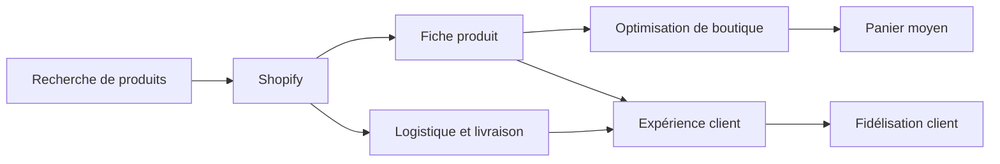

> [!moc] 03 · E-commerce
> **Mission** — Vendre en ligne et offrir une expérience client mémorable.
> **Périmètre** — Shopify, produits, boutiques, conversion, expérience client.

Retour : [[Accueil]] · [[Tableau de bord]]

## Cartographie du domaine
*Clique sur un nœud pour ouvrir la note. Les flèches suivent le chemin logique « vient de → mène à ».*



## Concepts fondamentaux
- [[Recherche de produits]]
- [[Shopify]]
- [[Fiche produit]]
- [[Optimisation de boutique]]
- [[Panier moyen]]
- [[Expérience client]]
- [[Fidélisation client]]
- [[Logistique et livraison]]
- *Nouveau concept ? Crée-le avec le modèle « Concept » et relie-le ici.*

## Ponts vers les autres domaines
- **[[Entrepreneuriat]]** — [[Recherche de produits]] ↔ [[Opportunités business]] · [[Recherche de produits]] ↔ [[Étude de marché]] · [[Shopify]] ↔ [[MVP et validation]]
- **[[Marketing digital]]** — [[Expérience client]] ↔ [[Conversion]] · [[Expérience client]] ↔ [[Psychologie du consommateur]] · [[Fiche produit]] ↔ [[Copywriting]] · [[Fidélisation client]] ↔ [[Email marketing]]
- **[[Intelligence artificielle]]** — [[Logistique et livraison]] ↔ [[Automatisation]]
- **[[Finances]]** — [[Fidélisation client]] ↔ [[Chiffre d'affaires]] · [[Logistique et livraison]] ↔ [[Marge]] · [[Panier moyen]] ↔ [[Chiffre d'affaires]] · [[Panier moyen]] ↔ [[Marge]]
- **[[Branding]]** — [[Expérience client]] ↔ [[Image de marque]] · [[Fiche produit]] ↔ [[Identité visuelle]] · [[Fidélisation client]] ↔ [[Image de marque]]
- **[[Création de contenu]]** — [[Recherche de produits]] ↔ [[TikTok]]
- **[[Technologie]]** — [[Shopify]] ↔ [[Création de sites internet]] · [[Shopify]] ↔ [[Hébergement et déploiement]] · [[Shopify]] ↔ [[No-code]]

## Mes notes dans ce domaine
*Idées, stratégies, apprentissages, lectures et projets qui citent ce domaine ou portent le tag `#domaine/ecommerce`.*

```base
filters:
  and:
    - or:
        - file.hasLink(this.file)
        - file.hasTag("domaine/ecommerce")
    - not:
        - file.inFolder("90 Système")
views:
  - type: table
    name: Mes notes liées
    filters:
      and:
        - 'type != "concept"'
        - 'type != "moc"'
    groupBy:
      property: type
      direction: ASC
    order:
      - file.name
      - type
      - statut
      - maj
    sort:
      - property: file.mtime
        direction: DESC
  - type: table
    name: Concepts du domaine
    filters:
      and:
        - 'type == "concept"'
    order:
      - file.name
      - tags
      - maj
    sort:
      - property: file.name
        direction: ASC
```

## Questions directrices
*Les grandes questions que je veux résoudre dans ce domaine.*
-
