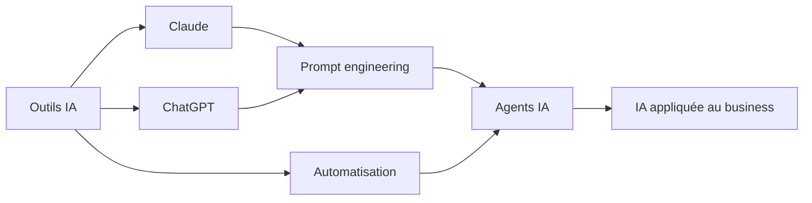

> [!moc] 04 · Intelligence artificielle
> **Mission** — Démultiplier mon efficacité avec l'IA.
> **Périmètre** — Claude, ChatGPT, automatisation, outils IA, agents intelligents.

Retour : [[Accueil]] · [[Tableau de bord]]

## Cartographie du domaine
*Clique sur un nœud pour ouvrir la note. Les flèches suivent le chemin logique « vient de → mène à ».*



## Concepts fondamentaux
- [[Outils IA]]
- [[Claude]]
- [[ChatGPT]]
- [[Prompt engineering]]
- [[Automatisation]]
- [[Agents IA]]
- [[IA appliquée au business]]
- *Nouveau concept ? Crée-le avec le modèle « Concept » et relie-le ici.*

## Ponts vers les autres domaines
- **[[Entrepreneuriat]]** — [[Automatisation]] ↔ [[Croissance et scaling]] · [[IA appliquée au business]] ↔ [[Croissance et scaling]] · [[IA appliquée au business]] ↔ [[Stratégie d'entreprise]]
- **[[Marketing digital]]** — [[Automatisation]] ↔ [[Email marketing]] · [[ChatGPT]] ↔ [[Copywriting]] · [[Prompt engineering]] ↔ [[Copywriting]]
- **[[E-commerce]]** — [[Automatisation]] ↔ [[Logistique et livraison]]
- **[[Création de contenu]]** — [[IA appliquée au business]] ↔ [[Stratégie de contenu]] · [[Outils IA]] ↔ [[Montage vidéo]] · [[Outils IA]] ↔ [[MotionLab]] · [[Prompt engineering]] ↔ [[Script vidéo]]
- **[[Développement personnel]]** — [[Automatisation]] ↔ [[Productivité]] · [[Outils IA]] ↔ [[Productivité]]
- **[[Technologie]]** — [[Agents IA]] ↔ [[Programmation]] · [[Agents IA]] ↔ [[Python]] · [[Automatisation]] ↔ [[No-code]] · [[Automatisation]] ↔ [[Python]]

## Mes notes dans ce domaine
*Idées, stratégies, apprentissages, lectures et projets qui citent ce domaine ou portent le tag `#domaine/ia`.*

```base
filters:
  and:
    - or:
        - file.hasLink(this.file)
        - file.hasTag("domaine/ia")
    - not:
        - file.inFolder("90 Système")
views:
  - type: table
    name: Mes notes liées
    filters:
      and:
        - 'type != "concept"'
        - 'type != "moc"'
    groupBy:
      property: type
      direction: ASC
    order:
      - file.name
      - type
      - statut
      - maj
    sort:
      - property: file.mtime
        direction: DESC
  - type: table
    name: Concepts du domaine
    filters:
      and:
        - 'type == "concept"'
    order:
      - file.name
      - tags
      - maj
    sort:
      - property: file.name
        direction: ASC
```

## Questions directrices
*Les grandes questions que je veux résoudre dans ce domaine.*
-
