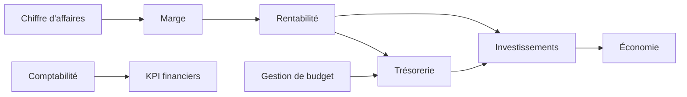

> [!moc] 05 · Finances
> **Mission** — Comprendre, piloter et faire fructifier l'argent.
> **Périmètre** — budget, comptabilité, rentabilité, investissements, économie.

Retour : [[Accueil]] · [[Tableau de bord]]

## Cartographie du domaine
*Clique sur un nœud pour ouvrir la note. Les flèches suivent le chemin logique « vient de → mène à ».*



## Concepts fondamentaux
- [[Chiffre d'affaires]]
- [[Marge]]
- [[Rentabilité]]
- [[Gestion de budget]]
- [[Comptabilité]]
- [[Trésorerie]]
- [[KPI financiers]]
- [[Investissements]]
- [[Économie]]
- *Nouveau concept ? Crée-le avec le modèle « Concept » et relie-le ici.*

## Ponts vers les autres domaines
- **[[Entrepreneuriat]]** — [[Chiffre d'affaires]] ↔ [[Modèle économique]] · [[Comptabilité]] ↔ [[Création d'entreprise]] · [[KPI financiers]] ↔ [[Stratégie d'entreprise]] · [[Rentabilité]] ↔ [[Modèle économique]]
- **[[Marketing digital]]** — [[Chiffre d'affaires]] ↔ [[Conversion]] · [[Gestion de budget]] ↔ [[Publicité]]
- **[[E-commerce]]** — [[Chiffre d'affaires]] ↔ [[Fidélisation client]] · [[Chiffre d'affaires]] ↔ [[Panier moyen]] · [[Marge]] ↔ [[Logistique et livraison]] · [[Marge]] ↔ [[Panier moyen]]
- **[[Développement personnel]]** — [[Gestion de budget]] ↔ [[Objectifs]] · [[Investissements]] ↔ [[Objectifs]]

## Mes notes dans ce domaine
*Idées, stratégies, apprentissages, lectures et projets qui citent ce domaine ou portent le tag `#domaine/finances`.*

```base
filters:
  and:
    - or:
        - file.hasLink(this.file)
        - file.hasTag("domaine/finances")
    - not:
        - file.inFolder("90 Système")
views:
  - type: table
    name: Mes notes liées
    filters:
      and:
        - 'type != "concept"'
        - 'type != "moc"'
    groupBy:
      property: type
      direction: ASC
    order:
      - file.name
      - type
      - statut
      - maj
    sort:
      - property: file.mtime
        direction: DESC
  - type: table
    name: Concepts du domaine
    filters:
      and:
        - 'type == "concept"'
    order:
      - file.name
      - tags
      - maj
    sort:
      - property: file.name
        direction: ASC
```

## Questions directrices
*Les grandes questions que je veux résoudre dans ce domaine.*
-
