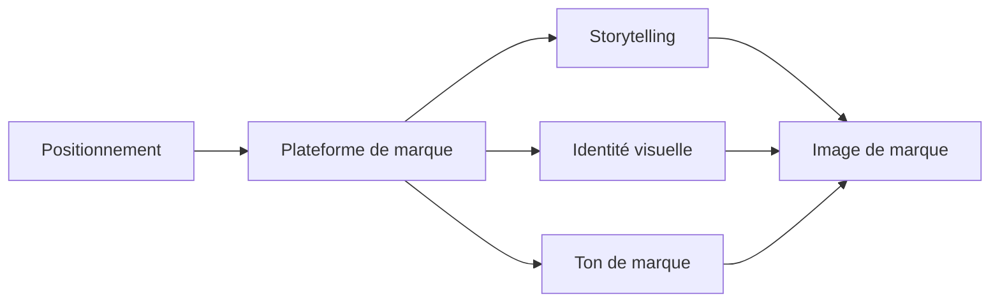

> [!moc] 06 · Branding
> **Mission** — Construire une marque reconnaissable et désirable.
> **Périmètre** — identité visuelle, storytelling, positionnement, image de marque.

Retour : [[Accueil]] · [[Tableau de bord]]

## Cartographie du domaine
*Clique sur un nœud pour ouvrir la note. Les flèches suivent le chemin logique « vient de → mène à ».*



## Concepts fondamentaux
- [[Positionnement]]
- [[Plateforme de marque]]
- [[Storytelling]]
- [[Identité visuelle]]
- [[Ton de marque]]
- [[Image de marque]]
- *Nouveau concept ? Crée-le avec le modèle « Concept » et relie-le ici.*

## Ponts vers les autres domaines
- **[[Entrepreneuriat]]** — [[Positionnement]] ↔ [[Proposition de valeur]] · [[Positionnement]] ↔ [[Étude de marché]]
- **[[Marketing digital]]** — [[Positionnement]] ↔ [[Persona client]] · [[Storytelling]] ↔ [[Copywriting]] · [[Storytelling]] ↔ [[Psychologie du consommateur]] · [[Ton de marque]] ↔ [[Copywriting]]
- **[[E-commerce]]** — [[Identité visuelle]] ↔ [[Fiche produit]] · [[Image de marque]] ↔ [[Expérience client]] · [[Image de marque]] ↔ [[Fidélisation client]]
- **[[Création de contenu]]** — [[Identité visuelle]] ↔ [[Instagram]] · [[Identité visuelle]] ↔ [[Montage vidéo]] · [[Plateforme de marque]] ↔ [[Stratégie de contenu]] · [[Storytelling]] ↔ [[Script vidéo]]
- **[[Technologie]]** — [[Identité visuelle]] ↔ [[Création de sites internet]] · [[Identité visuelle]] ↔ [[HTML et CSS]]

## Mes notes dans ce domaine
*Idées, stratégies, apprentissages, lectures et projets qui citent ce domaine ou portent le tag `#domaine/branding`.*

```base
filters:
  and:
    - or:
        - file.hasLink(this.file)
        - file.hasTag("domaine/branding")
    - not:
        - file.inFolder("90 Système")
views:
  - type: table
    name: Mes notes liées
    filters:
      and:
        - 'type != "concept"'
        - 'type != "moc"'
    groupBy:
      property: type
      direction: ASC
    order:
      - file.name
      - type
      - statut
      - maj
    sort:
      - property: file.mtime
        direction: DESC
  - type: table
    name: Concepts du domaine
    filters:
      and:
        - 'type == "concept"'
    order:
      - file.name
      - tags
      - maj
    sort:
      - property: file.name
        direction: ASC
```

## Questions directrices
*Les grandes questions que je veux résoudre dans ce domaine.*
-
