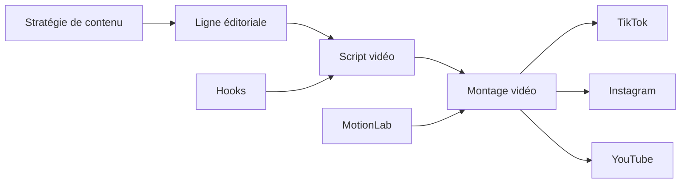

> [!moc] 07 · Création de contenu
> **Mission** — Produire du contenu qui capte l'attention et crée de la valeur.
> **Périmètre** — TikTok, Instagram, YouTube, montage, vidéos, MotionLab.

Retour : [[Accueil]] · [[Tableau de bord]]

## Cartographie du domaine
*Clique sur un nœud pour ouvrir la note. Les flèches suivent le chemin logique « vient de → mène à ».*



## Concepts fondamentaux
- [[Stratégie de contenu]]
- [[Ligne éditoriale]]
- [[Hooks]]
- [[Script vidéo]]
- [[Montage vidéo]]
- [[MotionLab]]
- [[TikTok]]
- [[Instagram]]
- [[YouTube]]
- *Nouveau concept ? Crée-le avec le modèle « Concept » et relie-le ici.*

## Ponts vers les autres domaines
- **[[Marketing digital]]** — [[Hooks]] ↔ [[Copywriting]] · [[Hooks]] ↔ [[Psychologie du consommateur]] · [[Instagram]] ↔ [[Acquisition]] · [[Instagram]] ↔ [[Publicité]]
- **[[E-commerce]]** — [[TikTok]] ↔ [[Recherche de produits]]
- **[[Intelligence artificielle]]** — [[Montage vidéo]] ↔ [[Outils IA]] · [[MotionLab]] ↔ [[Outils IA]] · [[Script vidéo]] ↔ [[Prompt engineering]] · [[Stratégie de contenu]] ↔ [[IA appliquée au business]]
- **[[Branding]]** — [[Instagram]] ↔ [[Identité visuelle]] · [[Ligne éditoriale]] ↔ [[Ton de marque]] · [[Montage vidéo]] ↔ [[Identité visuelle]] · [[Script vidéo]] ↔ [[Storytelling]]
- **[[Projets personnels]]** — [[MotionLab]] ↔ [[Projets personnels]]

## Mes notes dans ce domaine
*Idées, stratégies, apprentissages, lectures et projets qui citent ce domaine ou portent le tag `#domaine/contenu`.*

```base
filters:
  and:
    - or:
        - file.hasLink(this.file)
        - file.hasTag("domaine/contenu")
    - not:
        - file.inFolder("90 Système")
views:
  - type: table
    name: Mes notes liées
    filters:
      and:
        - 'type != "concept"'
        - 'type != "moc"'
    groupBy:
      property: type
      direction: ASC
    order:
      - file.name
      - type
      - statut
      - maj
    sort:
      - property: file.mtime
        direction: DESC
  - type: table
    name: Concepts du domaine
    filters:
      and:
        - 'type == "concept"'
    order:
      - file.name
      - tags
      - maj
    sort:
      - property: file.name
        direction: ASC
```

## Questions directrices
*Les grandes questions que je veux résoudre dans ce domaine.*
-
