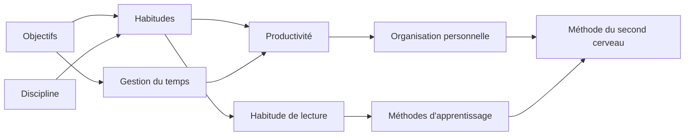

> [!moc] 08 · Développement personnel
> **Mission** — Devenir la meilleure version de moi-même, durablement.
> **Périmètre** — discipline, organisation, lecture, apprentissage, productivité.

Retour : [[Accueil]] · [[Tableau de bord]]

## Cartographie du domaine
*Clique sur un nœud pour ouvrir la note. Les flèches suivent le chemin logique « vient de → mène à ».*



## Concepts fondamentaux
- [[Objectifs]]
- [[Discipline]]
- [[Habitudes]]
- [[Gestion du temps]]
- [[Productivité]]
- [[Organisation personnelle]]
- [[Habitude de lecture]]
- [[Méthodes d'apprentissage]]
- [[Méthode du second cerveau]]
- *Nouveau concept ? Crée-le avec le modèle « Concept » et relie-le ici.*

## Ponts vers les autres domaines
- **[[Entrepreneuriat]]** — [[Objectifs]] ↔ [[Stratégie d'entreprise]]
- **[[Intelligence artificielle]]** — [[Productivité]] ↔ [[Automatisation]] · [[Productivité]] ↔ [[Outils IA]]
- **[[Finances]]** — [[Objectifs]] ↔ [[Gestion de budget]] · [[Objectifs]] ↔ [[Investissements]]
- **[[Technologie]]** — [[Méthodes d'apprentissage]] ↔ [[Programmation]]
- **[[Projets personnels]]** — [[Organisation personnelle]] ↔ [[Projets personnels]]

## Mes notes dans ce domaine
*Idées, stratégies, apprentissages, lectures et projets qui citent ce domaine ou portent le tag `#domaine/dev-perso`.*

```base
filters:
  and:
    - or:
        - file.hasLink(this.file)
        - file.hasTag("domaine/dev-perso")
    - not:
        - file.inFolder("90 Système")
views:
  - type: table
    name: Mes notes liées
    filters:
      and:
        - 'type != "concept"'
        - 'type != "moc"'
    groupBy:
      property: type
      direction: ASC
    order:
      - file.name
      - type
      - statut
      - maj
    sort:
      - property: file.mtime
        direction: DESC
  - type: table
    name: Concepts du domaine
    filters:
      and:
        - 'type == "concept"'
    order:
      - file.name
      - tags
      - maj
    sort:
      - property: file.name
        direction: ASC
```

## Questions directrices
*Les grandes questions que je veux résoudre dans ce domaine.*
-
