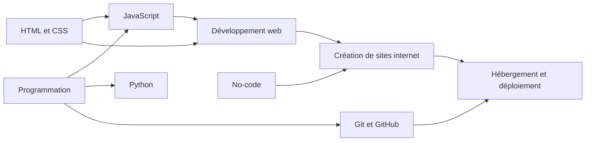

> [!moc] 09 · Technologie
> **Mission** — Comprendre et construire le web.
> **Périmètre** — développement web, programmation, création de sites Internet.

Retour : [[Accueil]] · [[Tableau de bord]]

## Cartographie du domaine
*Clique sur un nœud pour ouvrir la note. Les flèches suivent le chemin logique « vient de → mène à ».*



## Concepts fondamentaux
- [[Programmation]]
- [[HTML et CSS]]
- [[JavaScript]]
- [[Python]]
- [[Développement web]]
- [[Création de sites internet]]
- [[No-code]]
- [[Git et GitHub]]
- [[Hébergement et déploiement]]
- *Nouveau concept ? Crée-le avec le modèle « Concept » et relie-le ici.*

## Ponts vers les autres domaines
- **[[Entrepreneuriat]]** — [[No-code]] ↔ [[MVP et validation]]
- **[[Marketing digital]]** — [[Création de sites internet]] ↔ [[SEO]] · [[Création de sites internet]] ↔ [[Tunnel de vente]]
- **[[E-commerce]]** — [[Création de sites internet]] ↔ [[Shopify]] · [[Hébergement et déploiement]] ↔ [[Shopify]] · [[No-code]] ↔ [[Shopify]]
- **[[Intelligence artificielle]]** — [[Développement web]] ↔ [[Claude]] · [[No-code]] ↔ [[Automatisation]] · [[No-code]] ↔ [[Outils IA]] · [[Programmation]] ↔ [[Agents IA]]
- **[[Branding]]** — [[Création de sites internet]] ↔ [[Identité visuelle]] · [[HTML et CSS]] ↔ [[Identité visuelle]]
- **[[Développement personnel]]** — [[Programmation]] ↔ [[Méthodes d'apprentissage]]

## Mes notes dans ce domaine
*Idées, stratégies, apprentissages, lectures et projets qui citent ce domaine ou portent le tag `#domaine/tech`.*

```base
filters:
  and:
    - or:
        - file.hasLink(this.file)
        - file.hasTag("domaine/tech")
    - not:
        - file.inFolder("90 Système")
views:
  - type: table
    name: Mes notes liées
    filters:
      and:
        - 'type != "concept"'
        - 'type != "moc"'
    groupBy:
      property: type
      direction: ASC
    order:
      - file.name
      - type
      - statut
      - maj
    sort:
      - property: file.mtime
        direction: DESC
  - type: table
    name: Concepts du domaine
    filters:
      and:
        - 'type == "concept"'
    order:
      - file.name
      - tags
      - maj
    sort:
      - property: file.name
        direction: ASC
```

## Questions directrices
*Les grandes questions que je veux résoudre dans ce domaine.*
-
