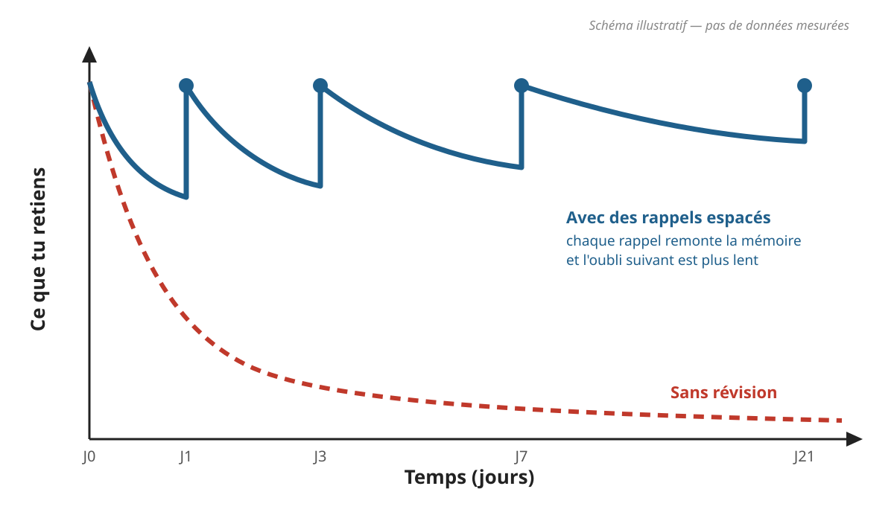

# 1. Comment ta mémoire fonctionne vraiment

Pour bien apprendre, pas besoin de devenir neuroscientifique. Mais quelques notions de base vont tout changer à ta façon de réviser. Une fois que tu sais comment ta mémoire enregistre, conserve et retrouve une information, les bonnes méthodes deviennent évidentes.

## Trois étapes : enregistrer, conserver, retrouver

Pour qu'une connaissance soit utilisable le jour du contrôle, trois choses doivent se produire :

1. **L'encodage** : l'information entre dans ta mémoire. C'est ce qui se passe quand tu écoutes le cours, lis une page ou fais un exercice.
2. **Le stockage** : l'information est conservée. Elle se « consolide » avec le temps, notamment pendant le sommeil.
3. **La récupération** : tu vas chercher l'information quand tu en as besoin, par exemple devant une question.

Beaucoup d'élèves ne travaillent que la première étape. Ils lisent, relisent, recopient : ils *encodent* encore et encore. Mais le jour du contrôle, c'est la **troisième** étape qui compte : retrouver l'information, sans le cours sous les yeux. Or la récupération est une compétence qui s'entraîne, comme un geste au sport. Si tu ne t'entraînes jamais à retrouver une information, tu ne seras pas bon pour la retrouver.

> **À retenir :** savoir reconnaître une information quand tu la vois (« ah oui, je connais ») n'est pas la même chose que savoir la retrouver de toi-même (« la réponse est… »). Les contrôles demandent presque toujours la seconde.

## La mémoire de travail : un tout petit bureau

Imagine ta mémoire comme une immense bibliothèque, avec un tout petit bureau à l'entrée. La bibliothèque, c'est ta **mémoire à long terme** : elle peut contenir une quantité énorme de connaissances, pendant des années. Le bureau, c'est ta **mémoire de travail** : l'espace où tu manipules les informations en ce moment même, pour comprendre une phrase, faire un calcul ou suivre un raisonnement.

Ce bureau est minuscule. Le chercheur Nelson Cowan a estimé en 2001 qu'on ne peut y garder qu'environ **quatre éléments** à la fois. C'est pour ça qu'il est difficile de retenir un numéro de téléphone entendu une seule fois, ou de suivre un cours quand le professeur va trop vite.

Cette limite a deux conséquences très pratiques :

- **Ne surcharge pas ton bureau.** Si tu essaies d'apprendre en écoutant de la musique avec des paroles, en répondant à des messages et en lisant ton cours, ton bureau est plein. Il ne reste presque plus de place pour apprendre. Le chercheur John Sweller a appelé ce phénomène la *charge cognitive*.
- **Range dans la bibliothèque.** Plus tu as de connaissances solides en mémoire à long terme, moins ton bureau est encombré. Un élève qui connaît ses tables de multiplication par cœur garde toute sa mémoire de travail pour comprendre le problème. Un élève qui doit recalculer 7 × 8 à chaque fois sature son bureau.

## La courbe de l'oubli

À la fin du XIXe siècle, un psychologue allemand, Hermann Ebbinghaus, a fait une expérience sur lui-même. Il a appris des listes de syllabes sans signification (comme « DAX », « BOK », « ZUF ») puis a mesuré, à différents moments, combien il en avait oublié. Il a publié ses résultats en 1885.

Sa découverte : **on oublie très vite au début, puis plus lentement.** Une grande partie de ce qu'on vient d'apprendre disparaît dans les heures et les jours qui suivent, puis la perte ralentit. En 2015, deux chercheurs néerlandais, Jaap Murre et Joeri Dros, ont refait l'expérience et retrouvé une courbe très similaire.

Attention : les syllabes sans signification sont bien plus difficiles à retenir qu'un cours que tu comprends. Les chiffres exacts d'Ebbinghaus ne s'appliquent donc pas tels quels à tes leçons. Mais le **principe** est le même pour tout le monde : sans action de ta part, tu oublies vite.

La bonne nouvelle, c'est que chaque fois que tu vas **rechercher** une information dans ta mémoire, la courbe remonte. Et la suivante descend moins vite. C'est tout le secret des méthodes que tu vas découvrir dans les prochains chapitres.

## Oublier n'est pas un échec

On a tendance à voir l'oubli comme un ennemi. En réalité, c'est un mécanisme normal et utile : si tu retenais tout ce que tu vois chaque jour (chaque affiche, chaque conversation, chaque pub), ta mémoire serait un chaos. Ton cerveau garde ce qui semble important, et le signal le plus fort qu'une information est importante, c'est que tu **en as besoin régulièrement**.

Quand tu te forces à retrouver une information au moment où elle commence à s'effacer, tu envoies exactement ce signal à ton cerveau : « ça, on en a besoin, garde-le ». C'est pour ça qu'un effort de mémoire un peu difficile est plus efficace qu'une relecture facile.

## Comprendre avant de retenir

Une dernière notion avant de passer à la pratique : on retient beaucoup mieux ce qu'on **comprend**. Une information isolée (« la bataille de Marignan, c'est 1515 ») tient mal. Une information reliée à d'autres (pourquoi cette bataille, qui l'a gagnée, quelle conséquence) s'accroche à un réseau de connaissances : elle a plusieurs « chemins d'accès » dans ta bibliothèque.

C'est pour ça que les meilleures méthodes combinent toujours deux choses : **comprendre** (créer des liens) et **s'entraîner à retrouver** (renforcer les chemins).

## Résumé du chapitre

- Apprendre, c'est enregistrer, conserver **et retrouver**. Les contrôles testent surtout la capacité à retrouver.
- Ta mémoire de travail est très limitée (environ 4 éléments) : évite de la surcharger avec des distractions.
- On oublie vite, puis plus lentement. Chaque effort pour retrouver une information ralentit l'oubli suivant.
- On retient mieux ce qu'on comprend et ce qu'on relie à ce qu'on sait déjà.

::: {.exercice}
**Exercice : le test des 2 minutes**

Prends le dernier cours que tu as étudié (n'importe quelle matière). Ferme ton cahier. Sur une feuille blanche, écris pendant 2 minutes tout ce dont tu te souviens, sans regarder. Puis ouvre ton cahier et compare.

Ce que tu as retrouvé, tu le sais vraiment. Le reste, tu croyais le savoir. Note ici les trois éléments que tu avais oubliés :
:::

::: {.lignes .petit}
 
:::
