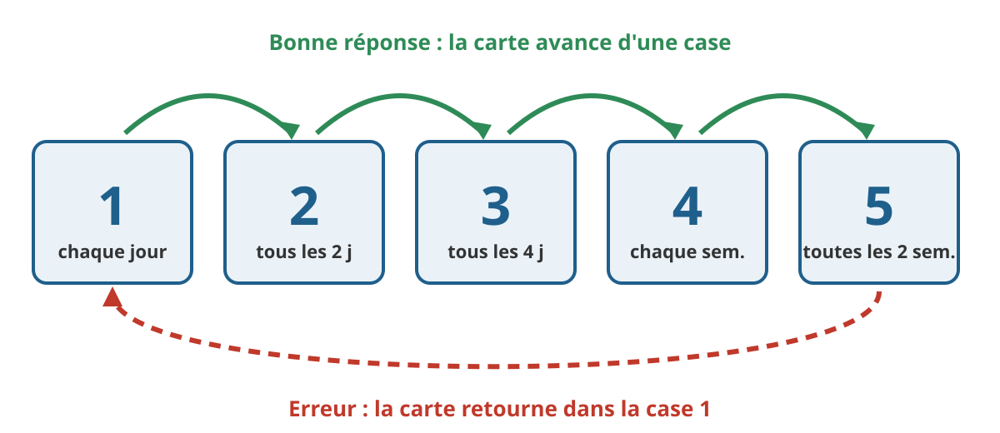

# 3. Méthode n°1 : se tester (la récupération active)

Si tu ne devais retenir qu'une seule méthode de ce livre, ce serait celle-ci. Se tester, c'est **essayer de retrouver une information de mémoire, sans regarder**. Les chercheurs appellent ça la *pratique de récupération*. Ce n'est pas seulement un moyen de vérifier ce qu'on sait : c'est l'un des moyens les plus efficaces de l'**apprendre**.

## L'expérience qui a tout changé

En 2006, deux chercheurs américains, Henry Roediger et Jeffrey Karpicke, ont demandé à des étudiants d'apprendre de courts textes scientifiques. Ils ont comparé plusieurs façons de travailler pendant le même temps :

- un groupe **relisait** le texte plusieurs fois ;
- un autre le lisait une fois, puis **essayait d'écrire de mémoire** tout ce dont il se souvenait, plusieurs fois.

Cinq minutes après la séance, les étudiants qui avaient relu s'en sortaient un peu mieux : la relecture donne de bons résultats à très court terme. Mais **une semaine plus tard**, la situation s'était inversée. Dans l'une de leurs expériences, ceux qui s'étaient testés à plusieurs reprises retrouvaient environ **61 %** du texte, contre environ **40 %** pour ceux qui avaient seulement relu.

Le plus frappant : les étudiants qui avaient relu étaient *plus confiants* que les autres. Ils pensaient mieux connaître le texte, alors qu'ils l'oubliaient plus vite. C'est l'illusion de maîtrise du chapitre 2, mesurée en laboratoire.

En 2011, Karpicke et Janell Blunt ont comparé le fait de se tester avec une méthode réputée très efficace : construire une carte mentale (*concept map*) du cours. Là encore, les étudiants qui s'étaient testés ont obtenu de meilleurs résultats une semaine plus tard, y compris sur des questions qui demandaient de faire des liens entre les idées.

## Pourquoi ça marche

Quand tu essaies de retrouver une information, ton cerveau doit parcourir le chemin qui y mène. Chaque fois que tu parcours ce chemin, il devient plus solide et plus facile à retrouver ensuite. Relire, au contraire, c'est comme regarder la carte sans jamais faire la randonnée.

Se tester a aussi un second avantage : cela te montre **précisément ce que tu ne sais pas**. Au lieu de réviser tout le chapitre de la même façon, tu peux concentrer ton énergie sur les trous.

> **Important :** se tromper ou bloquer pendant un test n'est pas grave. Au contraire : chercher, même sans trouver, puis vérifier la bonne réponse, aide à mieux la retenir. L'essentiel est de **toujours vérifier** juste après.

## 7 façons de se tester

### 1. La page blanche

Ferme ton cahier. Sur une feuille blanche, écris tout ce que tu sais sur le chapitre : définitions, dates, formules, schémas, exemples. Puis ouvre ton cours, compare, et complète **avec une autre couleur** ce que tu avais oublié. La prochaine fois, concentre-toi sur ce qui est dans cette couleur.

C'est la méthode la plus simple et l'une des plus puissantes. Elle marche dans toutes les matières.

### 2. Les questions dans la marge

Pendant ta première lecture du cours, écris dans la marge des questions dont la réponse se trouve dans le paragraphe : « Qu'est-ce que la photosynthèse ? », « Quelles sont les 3 conséquences de… ? ». Pour réviser, cache le texte avec une feuille et réponds aux questions à voix haute ou par écrit.

### 3. Les cartes mémoire (flashcards)

Sur un petit carton (ou une application), écris une question au recto et la réponse au verso. C'est idéal pour le vocabulaire, les dates, les définitions, les formules.

Quelques règles pour de bonnes cartes :

- **Une seule idée par carte.** « Les causes de la Première Guerre mondiale » est trop vaste. « Quel événement déclenche la crise de juillet 1914 ? » est mieux.
- **Formule une vraie question**, pas un mot isolé.
- **Dis la réponse avant de retourner la carte**, sinon tu ne te testes pas vraiment.
- **Mélange les cartes** à chaque fois, pour ne pas apprendre l'ordre.

### 4. La boîte de Leitner

Dans les années 1970, le journaliste allemand Sebastian Leitner a proposé un système simple pour organiser les cartes mémoire. Prends une boîte divisée en cinq compartiments :

| Compartiment | Quand le réviser |
|---|---|
| 1 | Tous les jours |
| 2 | Tous les 2 jours |
| 3 | Tous les 4 jours |
| 4 | Toutes les semaines |
| 5 | Toutes les 2 semaines |

Toutes les nouvelles cartes commencent dans le compartiment 1. Quand tu réponds juste, la carte avance d'un compartiment. Quand tu te trompes, elle retourne au compartiment 1. Ainsi, tu revois souvent ce que tu ne sais pas, et rarement ce que tu maîtrises. Les intervalles ci-dessus sont un exemple : tu peux les adapter à ton calendrier.

### 5. Refaire les exercices sans regarder la correction

En maths, en physique-chimie, en SVT, tu as souvent des exercices corrigés en classe. Relire la correction ne sert presque à rien. **Refais l'exercice sur une feuille blanche**, puis compare avec la correction. Si tu bloques, regarde seulement la première étape, puis continue seul.

### 6. Les annales et les sujets types

Pour le brevet, le bac ou les contrôles communs, les sujets des années précédentes sont souvent disponibles. Ce sont les meilleurs tests possibles : ils ressemblent exactement à ce qui t'attend. Fais-les en temps limité, comme un vrai examen.

### 7. Expliquer à voix haute

Explique le cours à voix haute, sans tes notes, comme si tu le présentais à quelqu'un. Là où tu hésites, tu as un trou. On reviendra sur cette méthode au chapitre 6.

## Combien de fois se tester ?

Les études montrent que se tester **plusieurs fois**, à des moments différents, est bien plus efficace qu'une seule fois. Un bon objectif : arriver à retrouver une information correctement **au moins trois fois, lors de séances différentes**. Et c'est là que la méthode n°2 entre en jeu : l'espacement.

## Résumé du chapitre

- Se tester (retrouver de mémoire) est l'une des méthodes les plus efficaces pour retenir à long terme.
- Dans l'étude de Roediger et Karpicke (2006), se tester plusieurs fois a donné environ 61 % de rappel une semaine plus tard, contre environ 40 % pour la relecture.
- Méthodes : page blanche, questions dans la marge, cartes mémoire, boîte de Leitner, refaire les exercices, annales, explication à voix haute.
- Toujours **vérifier** sa réponse juste après. Se tromper fait partie de l'apprentissage.

::: {.exercice}
**Exercice : tes 10 premières cartes**

Prends un chapitre que tu dois connaître pour ton prochain contrôle. Écris 10 questions précises dont tu devras connaître la réponse. Pour chacune, tente de répondre sans regarder, puis vérifie. Note ton score : ___ / 10.

Refais exactement le même test dans 2 jours, puis dans 5 jours. Note tes scores : ___ / 10 et ___ / 10.
:::
