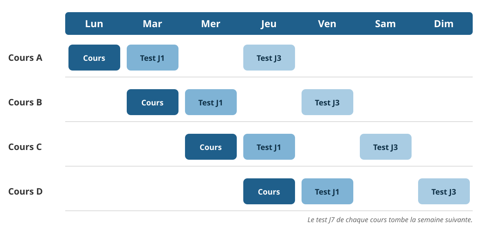

# 4. Méthode n°2 : espacer ses révisions

Imagine que tu as trois heures pour préparer un contrôle. Tu peux les utiliser d'un bloc, la veille au soir. Ou en six séances de 30 minutes réparties sur deux semaines. Le temps total est identique. Pourtant, dans la très grande majorité des études, la seconde option donne de bien meilleurs résultats à long terme. C'est l'**effet d'espacement**, l'un des résultats les plus solides de toute la psychologie de l'apprentissage.

## Ce que montrent les études

En 2006, Nicholas Cepeda et ses collègues ont rassemblé et analysé les résultats de 317 expériences, publiées dans 184 articles, qui comparaient l'apprentissage « massé » (tout d'un coup) et l'apprentissage « espacé » (réparti dans le temps). Leur conclusion est nette : **répartir ses séances améliore la mémorisation à long terme**, et ce bénéfice se retrouve de façon très régulière.

Ils ont aussi observé quelque chose d'intéressant : le meilleur écart entre deux révisions dépend du moment où tu dois te souvenir. Plus l'examen est lointain, plus les révisions peuvent être espacées. Pour un contrôle dans une semaine, des écarts d'un à deux jours fonctionnent bien. Pour un examen dans plusieurs mois, des écarts d'une ou plusieurs semaines deviennent intéressants.

## Pourquoi espacer marche mieux

Rappelle-toi la courbe de l'oubli du chapitre 1. Quand tu révises juste après avoir appris, l'information est encore « fraîche » : la retrouver ne demande aucun effort, donc cela ne renforce presque pas ta mémoire. Quand tu attends un peu, l'information commence à s'effacer. La retrouver demande un effort… et c'est cet effort qui la grave plus profondément.

C'est une **difficulté désirable**, selon l'expression du chercheur Robert Bjork : ce qui rend l'apprentissage un peu plus difficile sur le moment le rend plus durable.

> **Le bon moment pour réviser, c'est quand tu commences à oublier.** Pas quand tout est encore parfaitement en tête, et pas quand tout a disparu.

## Le calendrier de révision espacée

Voici un calendrier simple, à adapter. Le jour 0 est celui où tu as eu le cours.

| Quand | Quoi faire | Durée indicative |
|---|---|---|
| Jour 0 (le soir du cours) | Relire une fois pour comprendre, écrire les questions dans la marge | 10–15 min |
| Jour 1 | Premier test : page blanche ou questions | 10 min |
| Jour 3 | Deuxième test, concentré sur ce que tu avais oublié | 10 min |
| Jour 7 | Troisième test + quelques exercices | 15 min |
| Jour 21 | Test de vérification | 10 min |
| Avant l'examen | Test final type examen | selon l'examen |

Remarque l'essentiel : chaque séance est **courte**. L'espacement ne demande pas plus de temps de travail. Il demande surtout de **commencer plus tôt** et de **revenir plusieurs fois**.

## Comment l'organiser concrètement

### Le tableau de suivi

Sur une feuille (tu en trouveras une au chapitre 11), fais une ligne par chapitre ou par leçon, et des colonnes J1, J3, J7, J21. À chaque révision, coche la case et note ton score (par exemple 7/10). En un coup d'œil, tu vois ce qui doit être révisé aujourd'hui.

### L'agenda

Le jour où tu as un nouveau cours, écris directement dans ton agenda (papier ou téléphone) les rappels : « SVT ch.3 — test » à J+1, J+3 et J+7. Tu n'as plus à te demander quoi réviser : l'agenda te le dit.

### Les applications de cartes mémoire

Certaines applications de cartes mémoire (comme Anki, gratuite sur ordinateur et Android) calculent automatiquement quand te remontrer chaque carte, selon que tu as répondu juste ou non. C'est exactement le principe de la boîte de Leitner, automatisé.

## Et si le contrôle est demain ?

Ça arrive. Si tu n'as qu'une soirée, ne relis pas en boucle : **teste-toi** (chapitre 3), en commençant par ce que tu sais le moins. Fais deux ou trois courtes séances dans la soirée avec des pauses entre elles, plutôt qu'un seul bloc. Puis dors (chapitre 8). Et note dans ton agenda de reprendre ce chapitre dans trois jours : ce que tu as appris en urgence s'effacera vite si tu ne le revois pas.

## Résumé du chapitre

- À temps égal, réviser en plusieurs séances espacées est plus efficace que tout réviser d'un coup (Cepeda et al., 2006).
- Le meilleur moment pour réviser est quand l'information commence à s'effacer : l'effort de rappel la renforce.
- Calendrier simple : J1, J3, J7, J21, puis avant l'examen. Des séances courtes suffisent.
- L'agenda, un tableau de suivi ou une application de cartes mémoire rendent l'espacement automatique.

::: {.exercice}
**Exercice : programme tes 3 prochains rappels**

Choisis le dernier cours que tu as eu cette semaine. Écris les dates de tes trois prochaines séances de test :

J+1 : ______________  J+3 : ______________  J+7 : ______________

Mets-les dans ton agenda maintenant, avant de passer au chapitre suivant.
:::
