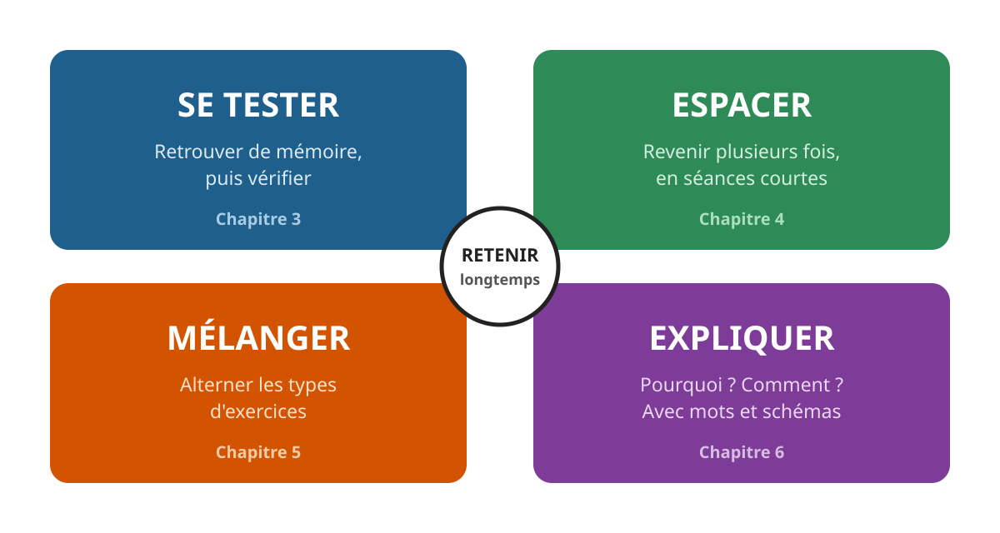

# 6. Méthode n°4 : comprendre et expliquer

Les trois méthodes précédentes t'aident à **retenir**. Celle-ci t'aide à **comprendre**, et ce que tu comprends, tu le retiens mieux et tu sais l'utiliser dans des situations nouvelles. C'est souvent ce qui fait la différence entre un 12 et un 16 : savoir répondre à une question à laquelle on ne s'attendait pas.

## Se demander « pourquoi ? »

Quand tu lis une information, pose-toi systématiquement la question : **« Pourquoi est-ce vrai ? »** ou **« Pourquoi cela s'est-il passé ? »**. Les chercheurs appellent ça l'*interrogation élaborative*. La revue de Dunlosky et ses collègues (2013) la classe parmi les techniques d'utilité modérée : elle aide, surtout quand tu as déjà des connaissances sur le sujet.

Exemples :

- « L'eau bout à 100 °C au niveau de la mer. » → *Pourquoi au niveau de la mer ? Que se passe-t-il en montagne ?*
- « La Révolution française éclate en 1789. » → *Pourquoi à ce moment-là ? Quelles étaient les causes ?*
- « En anglais, on utilise le *present perfect* pour une action passée liée au présent. » → *Pourquoi ne pas utiliser le prétérit ici ?*

Chaque « pourquoi » crée un lien entre la nouvelle information et ce que tu sais déjà. Plus il y a de liens, plus l'information est facile à retrouver.

## S'expliquer les étapes

L'*auto-explication* consiste à t'expliquer à toi-même, étape par étape, comment on arrive à un résultat. En 1994, Michelene Chi et ses collègues ont observé que des élèves à qui l'on demandait de s'expliquer ce qu'ils lisaient (dans un texte sur le système circulatoire) comprenaient mieux que ceux qui le lisaient simplement deux fois.

En pratique, devant un exercice corrigé, ne te contente pas de lire la correction. Pour chaque ligne, demande-toi : *« Qu'est-ce qu'on vient de faire ? Pourquoi cette étape ? Qu'est-ce qui permettait de savoir qu'il fallait faire ça ? »*

## Enseigner pour apprendre

Expliquer à quelqu'un d'autre (un ami, un frère, une sœur, ou même ton chat) t'oblige à organiser tes idées, à trouver tes propres mots et à repérer ce que tu ne comprends pas vraiment. C'est à la fois une méthode de compréhension **et** une forme de test (chapitre 3), puisque tu dois tout retrouver de mémoire.

On l'appelle parfois la « méthode Feynman », du nom du physicien Richard Feynman, réputé pour sa capacité à expliquer des idées complexes simplement. En voici une version en 4 étapes :

1. **Choisis une notion** et écris son nom en haut d'une feuille.
2. **Explique-la par écrit comme à un enfant de 12 ans**, avec des mots simples et un exemple. Sans regarder ton cours.
3. **Repère les endroits où tu bloques** ou où tu utilises des mots compliqués sans les comprendre. Retourne au cours pour ces points précis.
4. **Simplifie et recommence** jusqu'à ce que ton explication soit claire du début à la fin.

## Combiner les mots et les images

Le psychologue canadien Allan Paivio a proposé dans les années 1970 la théorie du *double codage* : une information mémorisée à la fois sous forme de mots **et** sous forme d'image a deux chemins d'accès au lieu d'un.

Concrètement :

- **Dessine** les processus : un schéma du cycle de l'eau, une frise chronologique, un croquis de carte.
- **Reproduis de mémoire** les schémas du cours, puis compare (c'est aussi un test !).
- **Associe** chaque grande idée à un exemple concret ou une image simple.

Pas besoin de savoir dessiner : des flèches, des boîtes et des mots-clés suffisent. L'important est que **tu** construises le schéma, plutôt que de regarder celui du manuel.

## Les cartes mentales : oui, mais…

Les cartes mentales (*mind maps*) sont populaires et peuvent aider à organiser un chapitre. Mais l'étude de Karpicke et Blunt (2011), citée au chapitre 3, montre qu'elles sont moins efficaces que le fait de se tester. La bonne solution est de **combiner** les deux : construis ta carte mentale une première fois avec ton cours, puis **reconstruis-la de mémoire** sur une feuille blanche lors des révisions suivantes.

## Résumé du chapitre

- Se demander « pourquoi ? » relie les nouvelles informations à ce que tu sais déjà.
- S'expliquer les étapes d'un raisonnement améliore la compréhension (Chi et al., 1994).
- Expliquer à quelqu'un (ou par écrit, comme à un enfant de 12 ans) révèle tes trous.
- Combine mots et images : dessine et reproduis les schémas de mémoire.
- Une carte mentale est plus utile si tu la reconstruis de mémoire.

::: {.exercice}
**Exercice : explique comme à un enfant de 12 ans**

Choisis une notion de ton cours qui te paraît difficile. Explique-la ici, sans regarder ton cahier, en 5 phrases maximum et avec un exemple.
:::

::: {.lignes}
 
:::
