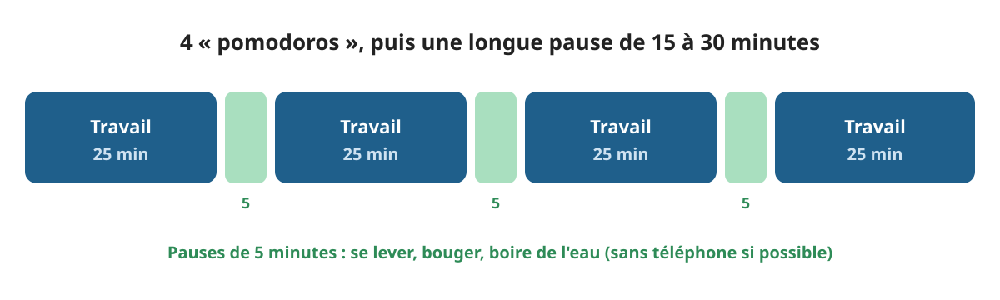

# 7. Rester concentré (même avec un téléphone)

Les meilleures méthodes du monde ne servent à rien si, toutes les trois minutes, une notification t'interrompt. Ce chapitre t'aide à créer les conditions pour que ton travail soit vraiment efficace. Bonne nouvelle : 25 minutes de travail réellement concentré valent souvent plus qu'une heure entrecoupée de distractions.

## Le mythe du multitâche

Beaucoup d'élèves pensent qu'ils peuvent réviser en répondant à leurs messages, en regardant une vidéo d'un œil ou en écoutant un podcast. En réalité, le cerveau ne fait pas vraiment deux tâches exigeantes en même temps : il **alterne** rapidement entre les deux. Et chaque changement a un coût. Il faut quelques instants pour « recharger » ce qu'on était en train de faire, et ta mémoire de travail (le petit bureau du chapitre 1) se remplit de choses qui n'ont rien à voir avec ton cours.

Résultat : tu as l'impression d'avoir travaillé une heure, alors que tu as réellement travaillé beaucoup moins, et moins bien.

## Le téléphone : hors de vue, hors de l'esprit

Le téléphone est la distraction numéro un, et pas seulement quand il sonne. En 2017, Adrian Ward et ses collègues ont publié une étude suggérant que la simple **présence** de son téléphone sur la table, même éteint, pouvait réduire légèrement les performances à des tests d'attention et de mémoire, par rapport à un téléphone laissé dans une autre pièce. D'autres équipes qui ont refait ce type d'expérience ont obtenu des résultats plus mitigés : l'effet n'est donc pas certain. Mais le conseil pratique, lui, ne coûte rien et ne présente aucun risque :

> **Pendant une séance de travail, mets ton téléphone dans une autre pièce**, ou au minimum dans un sac, en mode silencieux, hors de vue.

Si tu as besoin du téléphone pour une application de cartes mémoire, active le mode « Ne pas déranger » ou un mode « concentration », et coupe les notifications des réseaux sociaux.

## La technique Pomodoro

À la fin des années 1980, l'Italien Francesco Cirillo a créé une méthode simple pour travailler concentré, qu'il a appelée *Pomodoro* (« tomate » en italien), du nom de son minuteur de cuisine en forme de tomate. Le principe :

1. Choisis **une seule tâche** précise (« faire la page blanche du chapitre 4 de SVT »).
2. Lance un minuteur de **25 minutes**.
3. Travaille **uniquement** sur cette tâche jusqu'à la sonnerie. Si une idée parasite arrive (« il faut que je réponde à Léa »), note-la sur un papier et reviens au travail.
4. Fais une **pause de 5 minutes** : lève-toi, bois de l'eau, regarde par la fenêtre. Évite le téléphone si possible.
5. Après **4 séances**, fais une pause plus longue de 15 à 30 minutes.

Les durées sont indicatives : si 25 minutes te semblent trop longues au début, commence par 15 minutes. L'important est d'avoir des **blocs de concentration totale** suivis de **vraies pauses**.

## Préparer son espace de travail

- **Un endroit fixe** si possible : un bureau, une table, un coin de bibliothèque. Ton cerveau associe ce lieu au travail.
- **Tout le matériel à portée de main** avant de commencer : cours, feuilles, stylos, eau. Chaque fois que tu te lèves pour chercher quelque chose, tu risques de te disperser.
- **La musique ?** Les effets varient selon les personnes et les tâches. Prudence avec la musique à paroles : pour lire ou mémoriser, des mots chantés peuvent entrer en concurrence avec les mots que tu essaies d'apprendre. Si tu as besoin d'un fond sonore, essaie plutôt de la musique instrumentale calme ou le silence, et compare honnêtement tes résultats.
- **Une lumière suffisante** et une chaise où tu tiens assis sans t'avachir.

## Commencer, le plus dur

Souvent, le plus difficile n'est pas de travailler mais de **commencer**. Quelques astuces :

- **La règle des 2 minutes :** dis-toi que tu vas seulement ouvrir ton cahier et faire 2 minutes. Une fois lancé, continuer est beaucoup plus facile.
- **Une tâche précise plutôt qu'une tâche floue :** « réviser l'histoire » fait peur ; « faire 10 cartes sur la guerre froide » est concret.
- **Toujours à la même heure :** si tu travailles chaque jour à 17 h 30 après le goûter, ça devient une habitude et tu n'as plus besoin de te motiver.

## Prendre des notes : à la main ou sur ordinateur ?

En 2014, Pam Mueller et Daniel Oppenheimer ont publié une étude très médiatisée, intitulée *The Pen Is Mightier Than the Keyboard* (« le stylo est plus puissant que le clavier »). Elle suggérait que les étudiants qui prenaient des notes à la main comprenaient mieux les cours que ceux qui tapaient sur ordinateur. Mais en 2019, une équipe dirigée par Kayla Morehead a refait l'expérience et n'a pas retrouvé de différence nette.

Ce qu'on peut retenir avec prudence : le support compte probablement moins que **la façon** de prendre des notes. Recopier mot à mot ce que dit le professeur est peu utile. **Reformuler avec tes propres mots** et noter des questions est bien plus intéressant, que ce soit au stylo ou au clavier.

## Résumé du chapitre

- Le multitâche fait perdre du temps et de l'efficacité : une tâche à la fois.
- Mets ton téléphone hors de vue pendant les séances de travail.
- Pomodoro : 25 minutes de concentration totale, 5 minutes de pause, une longue pause après 4 séances.
- Prépare ton espace et ton matériel avant de commencer ; utilise la règle des 2 minutes pour démarrer.
- Pour les notes, reformuler compte plus que le choix entre stylo et clavier.

::: {.exercice}
**Exercice : ta première séance Pomodoro**

Ce soir, fais 2 séances de 25 minutes avec ton téléphone dans une autre pièce. Note le nombre de fois où tu as eu envie de le prendre : ______. Et ce que tu as accompli pendant ces 50 minutes :
:::

::: {.lignes .petit}
 
:::
