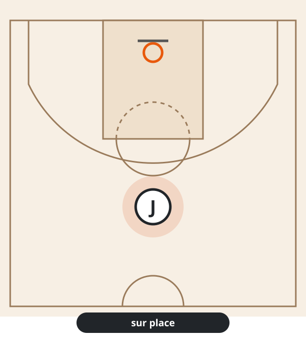
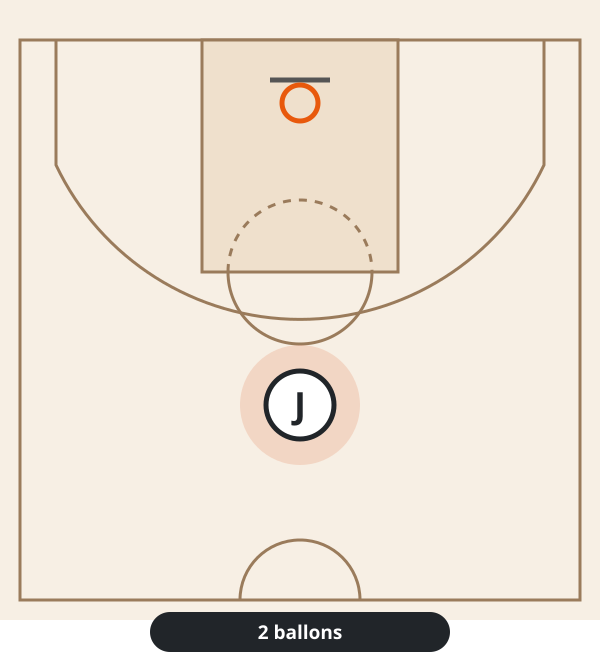
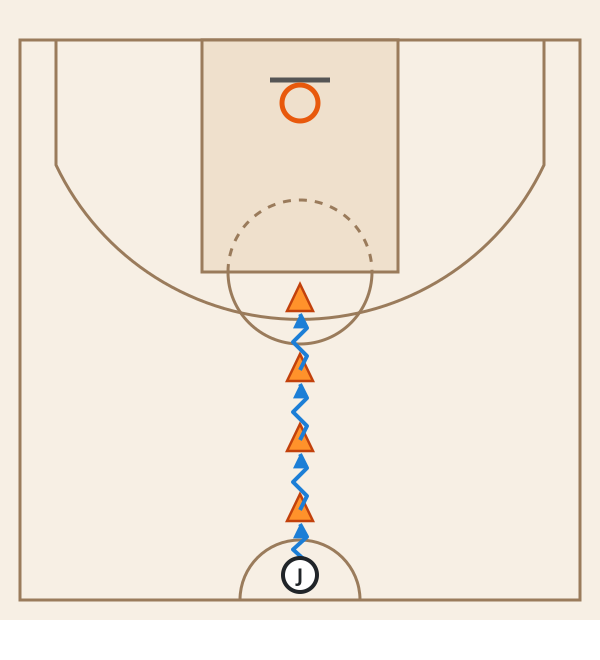
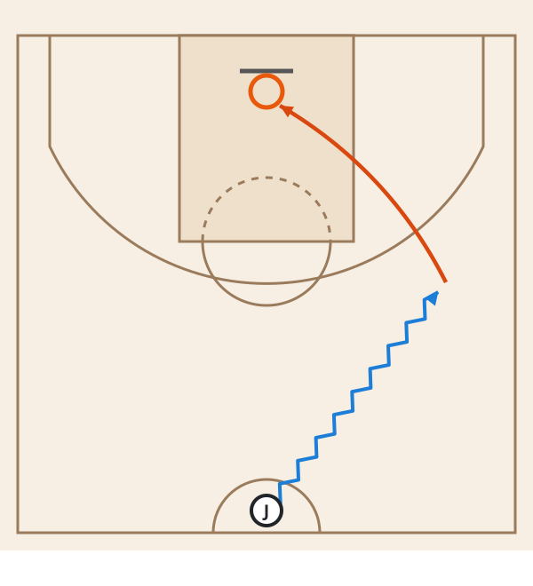
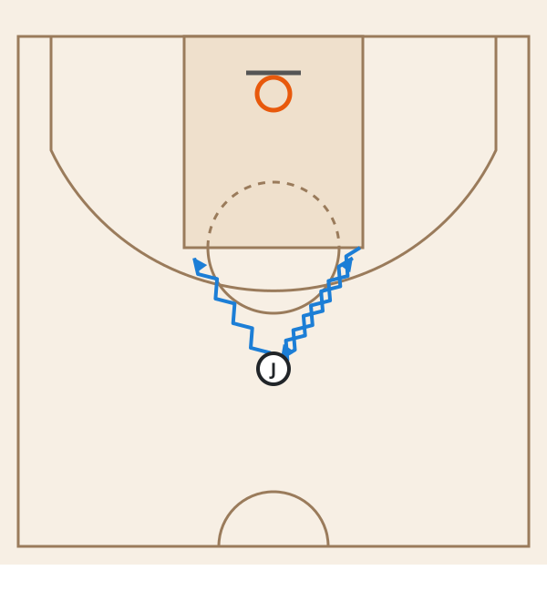
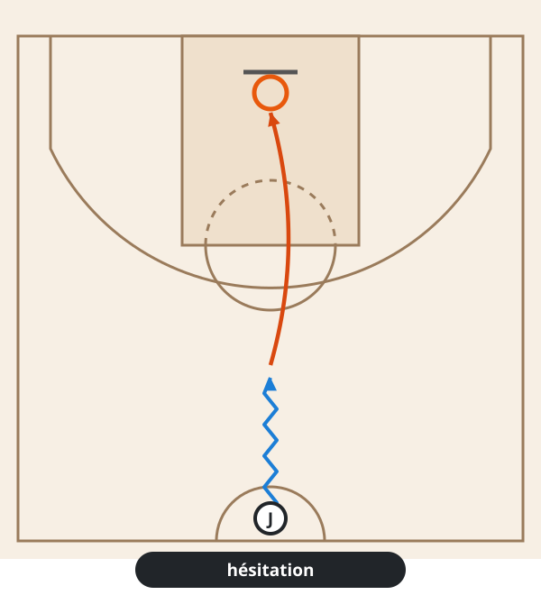
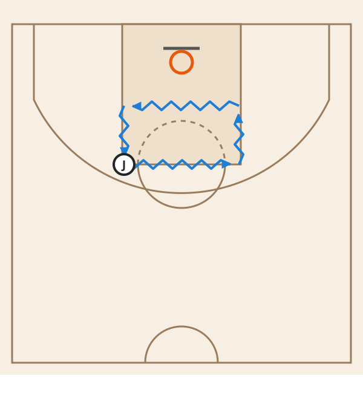
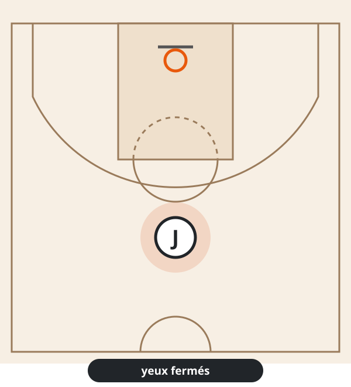
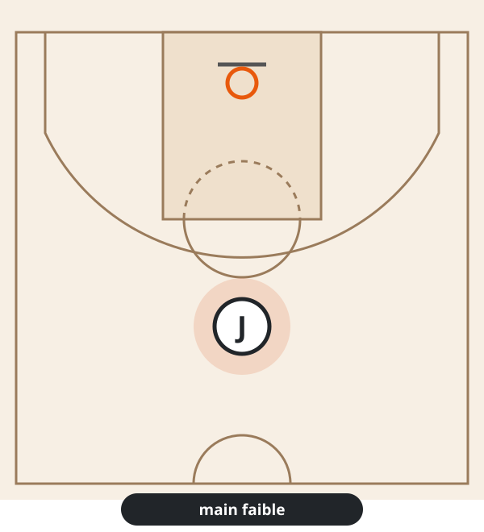

# 3. Dribble et maîtrise du ballon

Le dribble te permet d'avancer, de créer de l'espace et de garder le ballon sous pression. L'objectif est de dribbler sans regarder le ballon, des deux mains, à différentes hauteurs et vitesses. Dribble avec le bout des doigts et le poignet, pas avec la paume, et garde la tête haute.

## D01 · Dribble sur place, main forte puis main faible

::: {.exo}

::: {.exo-txt}
**Niveau** ●○○  ·  **Matériel :** Ballon

**Objectif.** Contrôler le ballon sans le regarder.

**Consigne.** Pieds écartés largeur d'épaules, genoux fléchis. Dribble à hauteur de hanche avec la main droite, en regardant devant toi (fixe un point sur le mur ou le panier). Puis main gauche.

**Volume.** 3 × 30 s par main

**Pour aller plus loin.** Dribble à hauteur de genou (rapide) puis à hauteur d'épaule (contrôle).

**Erreur fréquente.** Regarder le ballon. Astuce : compte à voix haute les doigts qu'un partenaire te montre.

**Mon meilleur score :** ________  **Date :** ________

**Notes :**

::: {.notes}
 
:::
:::

:::

## D02 · Changements de main devant soi (crossover)

::: {.exo}

::: {.exo-txt}
**Niveau** ●○○  ·  **Matériel :** Ballon

**Objectif.** Changer de main vite et bas.

**Consigne.** Dribble main droite, puis fais passer le ballon devant toi, bas (sous le genou), vers la main gauche. Continue gauche-droite en rythme.

**Volume.** 3 × 30 s

**Pour aller plus loin.** Deux dribbles de chaque côté avant de changer, puis un seul ; accélère.

**Erreur fréquente.** Ballon trop haut et trop large : un défenseur le volerait.

**Mon meilleur score :** ________  **Date :** ________

**Notes :**

::: {.notes}
 
:::
:::

:::

## D03 · Entre les jambes

::: {.exo}

::: {.exo-txt}
**Niveau** ●●○  ·  **Matériel :** Ballon

**Objectif.** Protéger le ballon en changeant de main.

**Consigne.** Fente avant, jambe gauche devant. Fais rebondir le ballon entre tes jambes de la main droite vers la main gauche. Change de jambe avant et recommence.

**Volume.** 3 × 20 répétitions

**Pour aller plus loin.** Enchaîne sans t'arrêter en changeant de jambe à chaque passage (marche avant).

**Erreur fréquente.** Rebond trop loin derrière : le ballon tape le talon.

**Mon meilleur score :** ________  **Date :** ________

**Notes :**

::: {.notes}
 
:::
:::

:::

## D04 · Dans le dos

::: {.exo}

::: {.exo-txt}
**Niveau** ●●○  ·  **Matériel :** Ballon

**Objectif.** Changer de main en protégeant le ballon avec le corps.

**Consigne.** Dribble main droite, puis enroule le ballon derrière ton dos pour qu'il rebondisse devant ta main gauche. Fais le geste lentement au début.

**Volume.** 3 × 15 par côté

**Pour aller plus loin.** En marchant, puis en trottinant le long de la ligne de touche.

**Erreur fréquente.** Ballon qui part trop en arrière : pousse-le vers l'avant de la main opposée.

**Mon meilleur score :** ________  **Date :** ________

**Notes :**

::: {.notes}
 
:::
:::

:::

## D05 · Combo des 3 changements

::: {.exo}

::: {.exo-txt}
**Niveau** ●●○  ·  **Matériel :** Ballon

**Objectif.** Enchaîner devant, entre les jambes et dans le dos.

**Consigne.** Enchaîne : crossover devant, puis entre les jambes, puis dans le dos. Recommence de l'autre côté.

**Volume.** 4 × 45 s

**Pour aller plus loin.** Ajoute un dribble rapide bas entre chaque changement.

**Erreur fréquente.** Se redresser entre les gestes : reste fléchi.

**Mon meilleur score :** ________  **Date :** ________

**Notes :**

::: {.notes}
 
:::
:::

:::

## D06 · Dribble à deux ballons

::: {.exo}

::: {.exo-txt}
**Niveau** ●●●  ·  **Matériel :** 2 ballons

**Objectif.** Renforcer la main faible et la coordination.

**Consigne.** Un ballon dans chaque main. Dribble les deux en même temps, puis en alternance (un monte, l'autre descend).

**Volume.** 4 × 30 s

**Pour aller plus loin.** Dribble bas puis haut ; en marchant vers l'avant.

**Erreur fréquente.** La main faible ralentit : laisse-la imposer le rythme.

**Mon meilleur score :** ________  **Date :** ________

**Notes :**

::: {.notes}
 
:::
:::

:::

## D07 · Huit autour des jambes

::: {.exo}

::: {.exo-txt}
**Niveau** ●○○  ·  **Matériel :** Ballon

**Objectif.** Sensation du ballon et rapidité des mains.

**Consigne.** Jambes écartées, fléchis-toi et fais passer le ballon en huit autour de tes jambes, sans dribbler, puis en dribblant bas.

**Volume.** 3 × 30 s

**Pour aller plus loin.** Change de sens toutes les 10 s.

**Erreur fréquente.** Les mains « attrapent » au lieu de guider : utilise le bout des doigts.

**Mon meilleur score :** ________  **Date :** ________

**Notes :**

::: {.notes}
 
:::
:::

:::

## D08 · Slalom entre les plots

::: {.exo}

::: {.exo-txt}
**Niveau** ●○○  ·  **Matériel :** Ballon, 5 plots (ou bouteilles)

**Objectif.** Dribbler en mouvement et changer de main à chaque plot.

**Consigne.** Place 5 plots en ligne espacés de 2 m. Dribble en slalom, en changeant de main à chaque plot (toujours la main éloignée du plot).

**Volume.** 6 allers-retours

**Pour aller plus loin.** Chronomètre-toi, puis utilise entre les jambes ou dans le dos à chaque plot.

**Erreur fréquente.** Garder la même main : le ballon doit toujours être du côté opposé au plot.

**Mon meilleur score :** ________  **Date :** ________

**Notes :**

::: {.notes}
 
:::
:::

:::

## D09 · Contre-attaque en dribble de vitesse

::: {.exo}

::: {.exo-txt}
**Niveau** ●○○  ·  **Matériel :** Ballon

**Objectif.** Dribbler vite en ligne droite et finir.

**Consigne.** Depuis le milieu du terrain, dribble le plus vite possible en poussant le ballon devant toi (3 à 4 dribbles maximum), puis termine par un double pas.

**Volume.** 8 répétitions (4 par côté)

**Pour aller plus loin.** Réduis le nombre de dribbles ; finis main faible.

**Erreur fréquente.** Dribbler trop haut et trop près des pieds : pousse le ballon devant.

**Mon meilleur score :** ________  **Date :** ________

**Notes :**

::: {.notes}
 
:::
:::

:::

## D10 · Arrêts et départs

::: {.exo}

::: {.exo-txt}
**Niveau** ●●○  ·  **Matériel :** Ballon

**Objectif.** Changer de rythme pour déséquilibrer un défenseur.

**Consigne.** Dribble en avançant, arrête-toi net en deux temps (un pied puis l'autre), compte 1, puis repars explosif. Répète sur toute la longueur.

**Volume.** 4 longueurs

**Pour aller plus loin.** Arrêt en un temps (les deux pieds ensemble), puis feinte de départ.

**Erreur fréquente.** Perdre le dribble à l'arrêt : garde le ballon bas pendant l'arrêt.

**Mon meilleur score :** ________  **Date :** ________

**Notes :**

::: {.notes}
 
:::
:::

:::

## D11 · Retrait (dribble en reculant)

::: {.exo}

::: {.exo-txt}
**Niveau** ●●○  ·  **Matériel :** Ballon

**Objectif.** Reculer pour créer de l'espace sans perdre le ballon.

**Consigne.** Avance en 2 dribbles, puis recule en 2 dribbles en gardant le corps entre le ballon et un défenseur imaginaire, puis change de main et attaque de l'autre côté.

**Volume.** 3 × 6 répétitions

**Pour aller plus loin.** Enchaîne retrait + crossover + accélération.

**Erreur fréquente.** Tourner le dos au panier : reste de profil, la tête vers le panier.

**Mon meilleur score :** ________  **Date :** ________

**Notes :**

::: {.notes}
 
:::
:::

:::

## D12 · Le dribble « hésitation »

::: {.exo}

::: {.exo-txt}
**Niveau** ●●●  ·  **Matériel :** Ballon

**Objectif.** Faire croire à un arrêt puis accélérer.

**Consigne.** En dribblant à mi-vitesse, relève légèrement le buste et ralentis (comme pour t'arrêter), puis repousse le ballon devant toi et accélère.

**Volume.** 8 répétitions par main

**Pour aller plus loin.** Combine hésitation + crossover.

**Erreur fréquente.** Ralentir sans relever le buste : la feinte n'est pas crédible.

**Mon meilleur score :** ________  **Date :** ________

**Notes :**

::: {.notes}
 
:::
:::

:::

## D13 · Dribble autour de la raquette

::: {.exo}

::: {.exo-txt}
**Niveau** ●●○  ·  **Matériel :** Ballon

**Objectif.** Dribbler en courbe et en changeant de main.

**Consigne.** Fais le tour de la raquette en dribblant, main extérieure (main droite quand tu tournes dans le sens inverse des aiguilles d'une montre). Change de sens et de main à chaque tour.

**Volume.** 6 tours

**Pour aller plus loin.** Accélère dans les virages ; ajoute un changement de main à chaque coin.

**Erreur fréquente.** Couper les virages : longe les lignes.

**Mon meilleur score :** ________  **Date :** ________

**Notes :**

::: {.notes}
 
:::
:::

:::

## D14 · Dribble les yeux fermés

::: {.exo}

::: {.exo-txt}
**Niveau** ●●○  ·  **Matériel :** Ballon, endroit sûr et dégagé

**Objectif.** Développer la sensation du ballon.

**Consigne.** Sur place uniquement : dribble main droite les yeux fermés, puis main gauche, puis crossovers. Ouvre les yeux si tu perds le ballon.

**Volume.** 3 × 30 s

**Pour aller plus loin.** Dribble bas et rapide, yeux fermés.

**Erreur fréquente.** Se déplacer les yeux fermés : reste sur place pour ta sécurité.

**Mon meilleur score :** ________  **Date :** ________

**Notes :**

::: {.notes}
 
:::
:::

:::

## D15 · Le défi des 100 dribbles

::: {.exo}

::: {.exo-txt}
**Niveau** ●○○  ·  **Matériel :** Ballon

**Objectif.** Endurance de la main faible.

**Consigne.** Fais 100 dribbles bas consécutifs avec ta main faible sans perdre le ballon. Si tu le perds, recommence à zéro.

**Volume.** 1 à 3 réussites

**Pour aller plus loin.** 200 dribbles ; ou 100 en alternant bas/haut toutes les 10.

**Erreur fréquente.** Changer de main en cachette : reste honnête, c'est ta main faible qui progresse.

**Mon meilleur score :** ________  **Date :** ________

**Notes :**

::: {.notes}
 
:::
:::

:::
