# 4. Tir

Un bon tir repose sur une mécanique répétable : pieds alignés, coude sous le ballon, extension complète et poignet cassé à la fin (le « col de cygne »). Commence près du panier, valide ta mécanique, puis recule. Compte toujours tes tirs réussis : ce qui se mesure progresse.

## T01 · Tir à une main près du panier

::: {.exo}

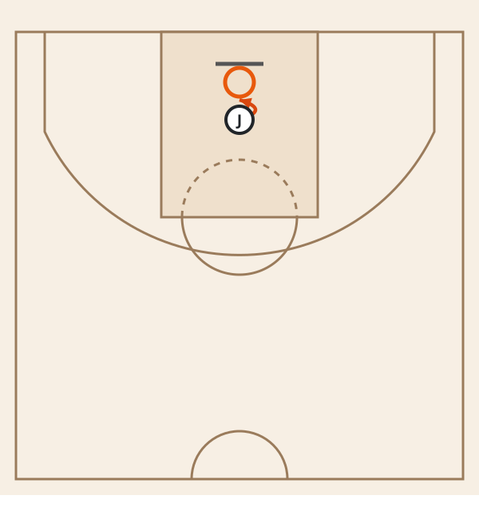

::: {.exo-txt}
**Niveau** ●○○  ·  **Matériel :** Ballon

**Objectif.** Construire une mécanique propre.

**Consigne.** À 1 m du panier, face à lui. Ballon dans la main de tir seulement, coude sous le ballon. Tire en extension complète et garde le poignet cassé jusqu'à ce que le ballon touche le cercle.

**Volume.** 5 séries de 10, compte tes réussites

**Pour aller plus loin.** Recule d'un pas quand tu réussis 8/10.

**Erreur fréquente.** Coude qui part sur le côté : le ballon part de travers.

**Mon meilleur score :** ________  **Date :** ________

**Notes :**

::: {.notes}
 
:::
:::

:::

## T02 · Le tour du monde près du panier

::: {.exo}

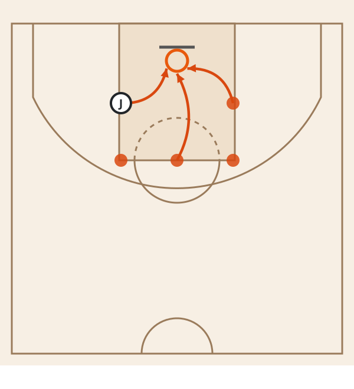

::: {.exo-txt}
**Niveau** ●○○  ·  **Matériel :** Ballon

**Objectif.** Tirer sous tous les angles.

**Consigne.** Cinq positions à 2–3 m du panier (deux côtés de la ligne de fond, deux angles à 45°, face). Marque 2 paniers à chaque position avant de passer à la suivante.

**Volume.** 2 tours

**Pour aller plus loin.** Passe à mi-distance (4–5 m).

**Erreur fréquente.** Changer de mécanique selon l'angle : seuls tes pieds s'orientent.

**Mon meilleur score :** ________  **Date :** ________

**Notes :**

::: {.notes}
 
:::
:::

:::

## T03 · Lancers francs : la routine

::: {.exo}

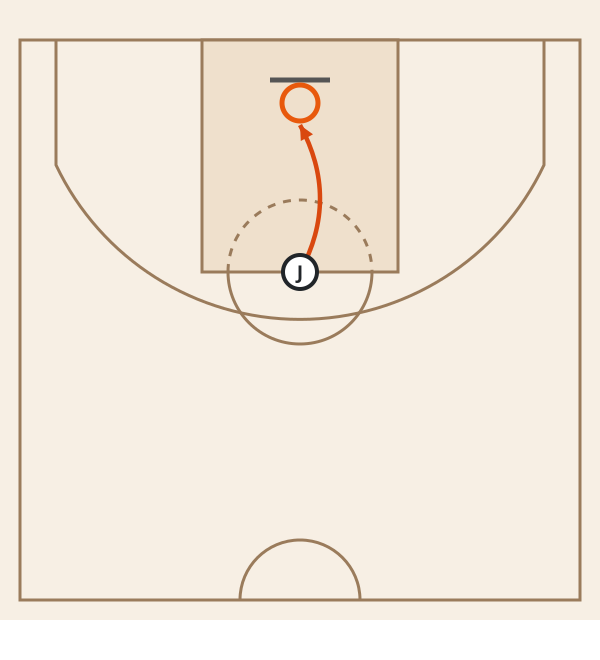

::: {.exo-txt}
**Niveau** ●○○  ·  **Matériel :** Ballon

**Objectif.** Créer une routine identique à chaque tir.

**Consigne.** Définis ta routine : même placement des pieds, mêmes dribbles (par exemple 2), une respiration, puis tir. Fais 10 lancers et note ton score.

**Volume.** 3 × 10, note chaque série

**Pour aller plus loin.** Fais 10 sauts ou 1 aller-retour en courant avant chaque série pour tirer fatigué, comme en match.

**Erreur fréquente.** Changer de routine à chaque tir.

**Mon meilleur score :** ________  **Date :** ________

**Notes :**

::: {.notes}
 
:::
:::

:::

## T04 · Tir après réception (passe à soi-même)

::: {.exo}

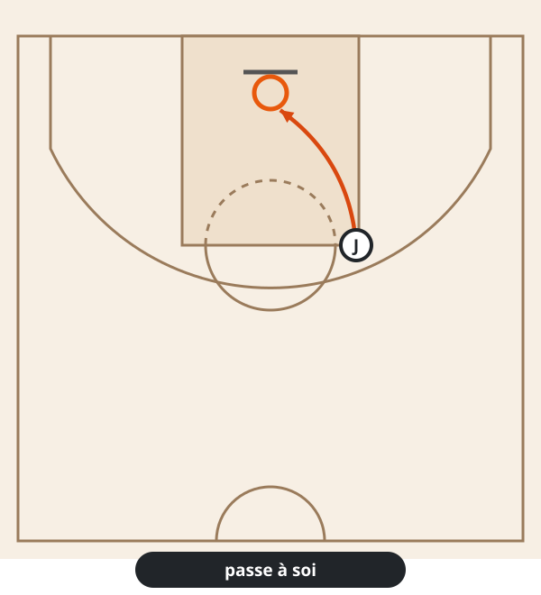

::: {.exo-txt}
**Niveau** ●●○  ·  **Matériel :** Ballon

**Objectif.** Tirer en équilibre après une réception.

**Consigne.** Fais-toi une passe en lançant le ballon devant toi avec un effet rétro (il revient vers toi). Réceptionne en un temps, pieds orientés vers le panier, et tire.

**Volume.** 5 positions × 5 tirs

**Pour aller plus loin.** Réception en deux temps, puis en sautant.

**Erreur fréquente.** Tirer en déséquilibre vers l'arrière.

**Mon meilleur score :** ________  **Date :** ________

**Notes :**

::: {.notes}
 
:::
:::

:::

## T05 · Tir en sortie de dribble

::: {.exo}

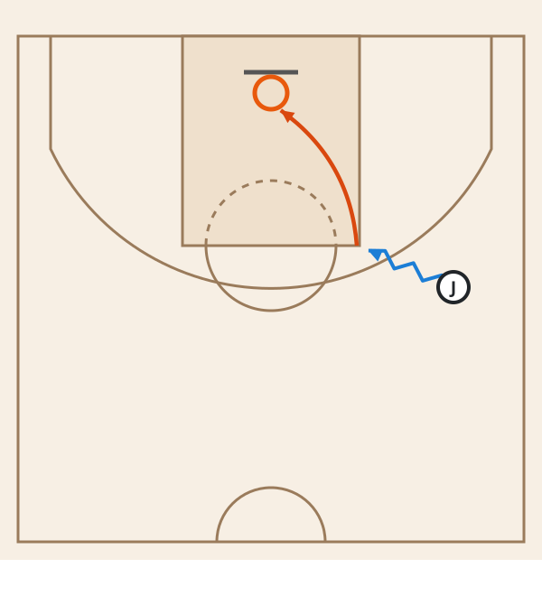

::: {.exo-txt}
**Niveau** ●●○  ·  **Matériel :** Ballon

**Objectif.** S'arrêter en équilibre et tirer après un dribble.

**Consigne.** Depuis l'aile, un dribble vers le centre, arrêt en un temps, tir. Puis un dribble vers la ligne de fond.

**Volume.** 4 × 6 tirs par côté

**Pour aller plus loin.** Deux dribbles, puis un changement de main avant le tir.

**Erreur fréquente.** Dérive latérale : ton corps doit monter droit.

**Mon meilleur score :** ________  **Date :** ________

**Notes :**

::: {.notes}
 
:::
:::

:::

## T06 · Le « catch & shoot » sur 5 positions

::: {.exo}

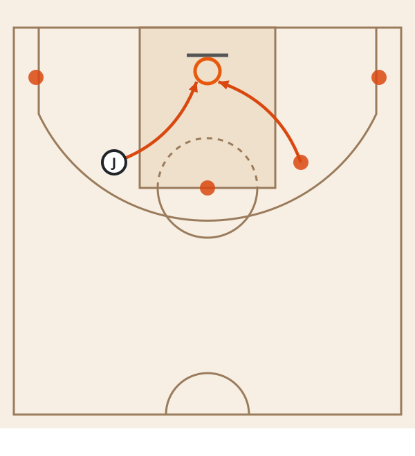

::: {.exo-txt}
**Niveau** ●●○  ·  **Matériel :** Ballon

**Objectif.** Tir à mi-distance rapide.

**Consigne.** Tire depuis 5 positions à 4–5 m. Après chaque tir, récupère le rebond le plus vite possible et sprint vers la position suivante.

**Volume.** 3 tours de 10 tirs

**Pour aller plus loin.** Recule derrière la ligne à 3 points quand tu réussis 6/10.

**Erreur fréquente.** Négliger le replacement : sprint entre les tirs.

**Mon meilleur score :** ________  **Date :** ________

**Notes :**

::: {.notes}
 
:::
:::

:::

## T07 · Tirs à 3 points depuis les coins

::: {.exo}

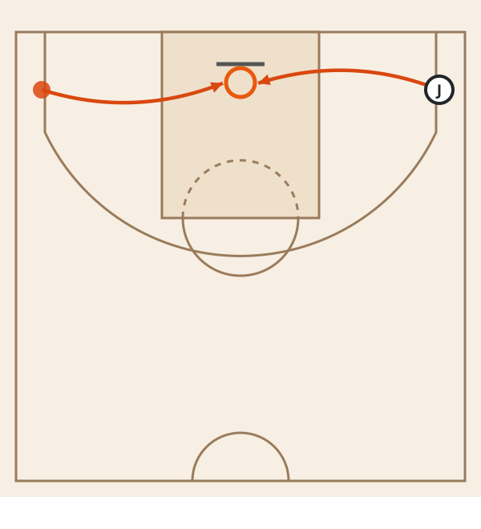

::: {.exo-txt}
**Niveau** ●●●  ·  **Matériel :** Ballon

**Objectif.** Le 3 points le plus court (6,60 m dans les coins selon les règles FIBA).

**Consigne.** Place-toi dans le coin, pieds juste derrière la ligne. Tire 10 fois, puis change de coin.

**Volume.** 4 × 10

**Pour aller plus loin.** Réception + tir rapide après une course depuis l'aile.

**Erreur fréquente.** Marcher sur la ligne : regarde tes pieds avant de commencer.

**Mon meilleur score :** ________  **Date :** ________

**Notes :**

::: {.notes}
 
:::
:::

:::

## T08 · Le défi des 5 positions à 3 points

::: {.exo}

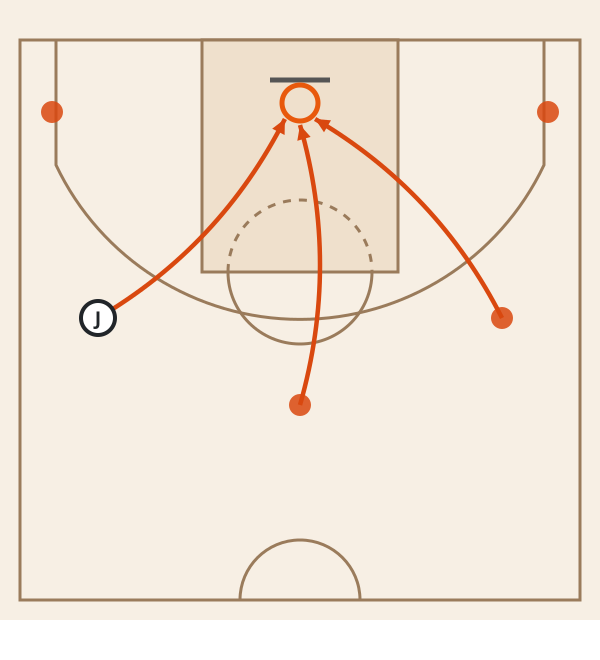

::: {.exo-txt}
**Niveau** ●●●  ·  **Matériel :** Ballon

**Objectif.** Tir longue distance sous pression.

**Consigne.** Cinq positions derrière la ligne (coins, ailes, axe). 5 tirs par position. Note ton total sur 25.

**Volume.** 2 défis, note les deux scores

**Pour aller plus loin.** Une position ne compte que si tu marques au moins 2 tirs sur 5.

**Erreur fréquente.** Forcer avec les bras : la puissance vient des jambes.

**Mon meilleur score :** ________  **Date :** ________

**Notes :**

::: {.notes}
 
:::
:::

:::

## T09 · Tir face à une main levée (balai ou chaise)

::: {.exo}

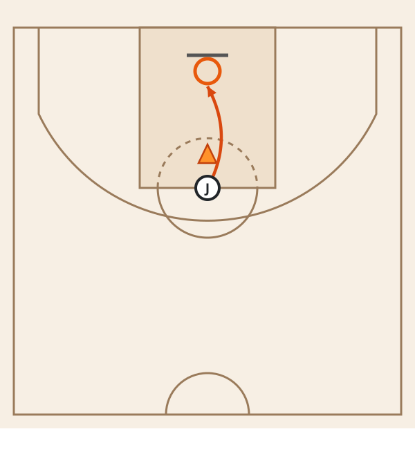

::: {.exo-txt}
**Niveau** ●●○  ·  **Matériel :** Ballon, un balai calé dans une chaise devant toi (environ 1 m)

**Objectif.** Tirer avec une trajectoire plus haute.

**Consigne.** Tire par-dessus l'obstacle à mi-distance. La trajectoire doit monter franchement.

**Volume.** 4 × 10

**Pour aller plus loin.** Rapproche l'obstacle.

**Erreur fréquente.** Tir à plat : vise une trajectoire en cloche.

**Mon meilleur score :** ________  **Date :** ________

**Notes :**

::: {.notes}
 
:::
:::

:::

## T10 · Tir en step-back (pas en arrière)

::: {.exo}

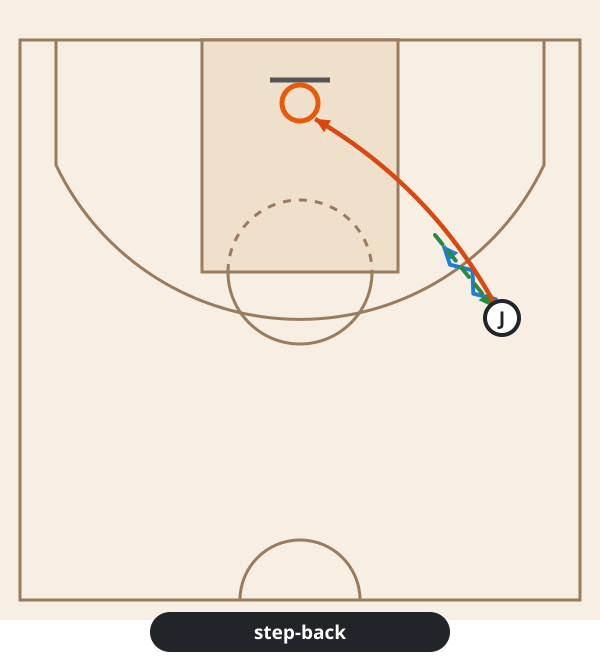

::: {.exo-txt}
**Niveau** ●●●  ·  **Matériel :** Ballon

**Objectif.** Créer de l'espace avant de tirer.

**Consigne.** Attaque en dribble vers le panier, puis repousse-toi d'un saut en arrière avec les deux pieds, réception équilibrée, tir.

**Volume.** 3 × 6 par côté

**Pour aller plus loin.** Combine avec une feinte d'épaule.

**Erreur fréquente.** Reculer de travers : recule droit, épaules face au panier.

**Mon meilleur score :** ________  **Date :** ________

**Notes :**

::: {.notes}
 
:::
:::

:::

## T11 · Tir du « coude » après un écran imaginaire

::: {.exo}

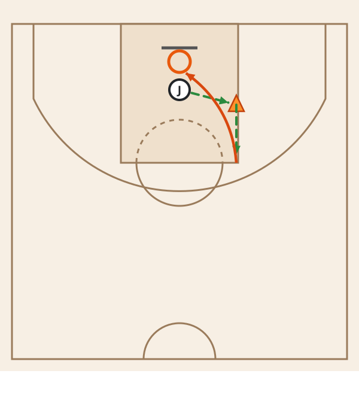

::: {.exo-txt}
**Niveau** ●●○  ·  **Matériel :** Ballon, 1 plot

**Objectif.** Tirer en sortie de course.

**Consigne.** Pars sous le panier, cours autour d'un plot placé au poste bas comme si tu sortais d'un écran, reçois ta propre passe au coude et tire.

**Volume.** 4 × 5 par côté

**Pour aller plus loin.** Course en courbe plus serrée et plus rapide.

**Erreur fréquente.** S'arrêter longtemps avant de tirer.

**Mon meilleur score :** ________  **Date :** ________

**Notes :**

::: {.notes}
 
:::
:::

:::

## T12 · Le tir « sans ballon » (mécanique)

::: {.exo}

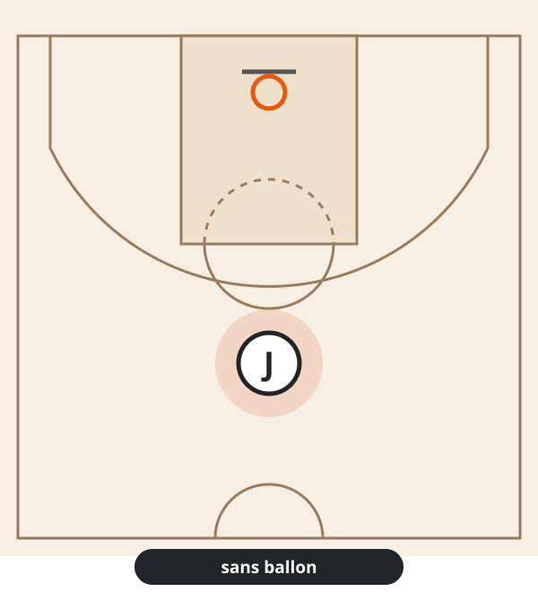

::: {.exo-txt}
**Niveau** ●○○  ·  **Matériel :** Aucun (ou un miroir)

**Objectif.** Graver la mécanique dans ton corps.

**Consigne.** Devant un miroir, mime le geste de tir lentement : flexion, extension, poignet cassé. Puis allongé sur le dos, tire le ballon vers le plafond et rattrape-le.

**Volume.** 3 × 20 gestes

**Pour aller plus loin.** Les yeux fermés, en sentant chaque étape.

**Erreur fréquente.** Aller trop vite : la lenteur rend le geste précis.

**Mon meilleur score :** ________  **Date :** ________

**Notes :**

::: {.notes}
 
:::
:::

:::

## T13 · Tirs rapprochés en rafale

::: {.exo}

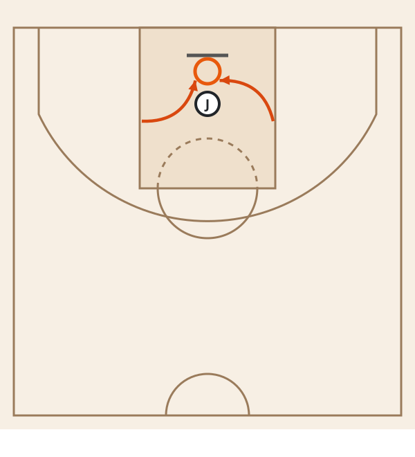

::: {.exo-txt}
**Niveau** ●○○  ·  **Matériel :** Ballon

**Objectif.** Toucher et régularité près du panier.

**Consigne.** Sous le panier, enchaîne des tirs rapprochés de chaque côté (main droite à droite, main gauche à gauche), en récupérant le ballon avant qu'il ne touche le sol si possible.

**Volume.** 3 × 1 min, compte tes réussites

**Pour aller plus loin.** Ajoute des tirs en revers.

**Erreur fréquente.** Lever la tête trop tard : vise la planche tôt.

**Mon meilleur score :** ________  **Date :** ________

**Notes :**

::: {.notes}
 
:::
:::

:::

## T14 · Tirs en fatigue

::: {.exo}

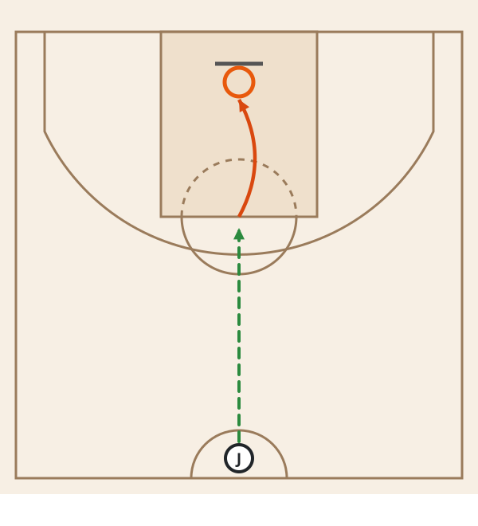

::: {.exo-txt}
**Niveau** ●●●  ·  **Matériel :** Ballon

**Objectif.** Garder la mécanique quand le corps est fatigué.

**Consigne.** Fais 10 sauts sur place ou un aller-retour en courant, puis 2 tirs à mi-distance. Répète.

**Volume.** 8 cycles

**Pour aller plus loin.** Lancers francs après chaque sprint.

**Erreur fréquente.** Bâcler le tir pour aller vite : la qualité d'abord.

**Mon meilleur score :** ________  **Date :** ________

**Notes :**

::: {.notes}
 
:::
:::

:::

## T15 · Le défi des 10 réussites d'affilée

::: {.exo}

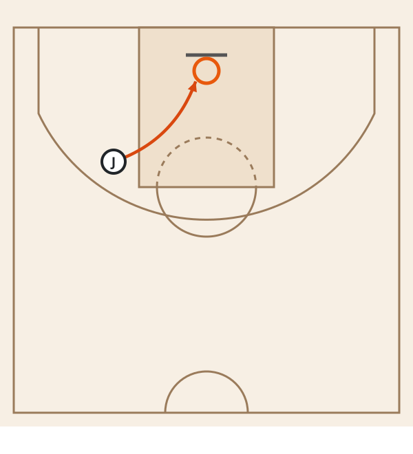

::: {.exo-txt}
**Niveau** ●●○  ·  **Matériel :** Ballon

**Objectif.** Concentration et régularité.

**Consigne.** Choisis une position à mi-distance. Objectif : 10 tirs réussis consécutifs. Un échec remet le compteur à zéro. Note ton record.

**Volume.** 1 défi par séance

**Pour aller plus loin.** Change de position une fois le défi réussi.

**Erreur fréquente.** Tirer trop vite après un échec : respire, refais ta routine.

**Mon meilleur score :** ________  **Date :** ________

**Notes :**

::: {.notes}
 
:::
:::

:::
