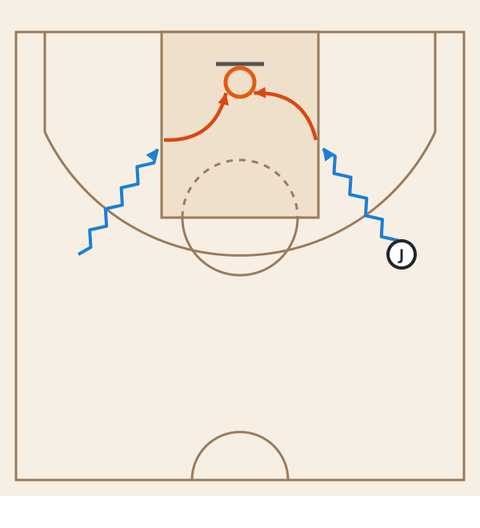
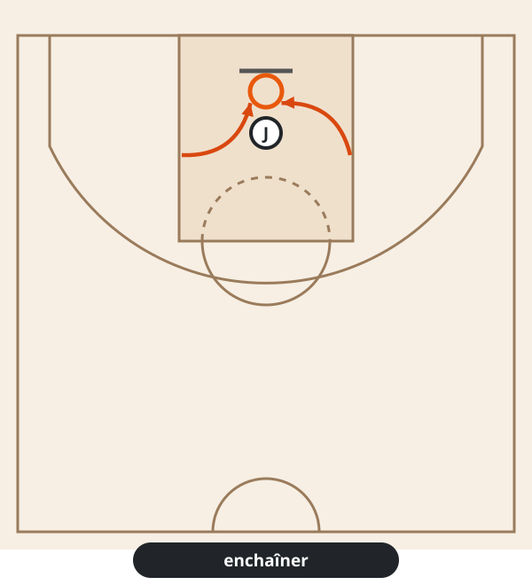
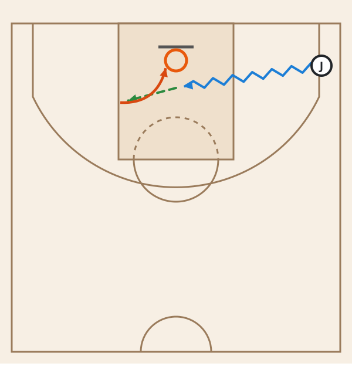
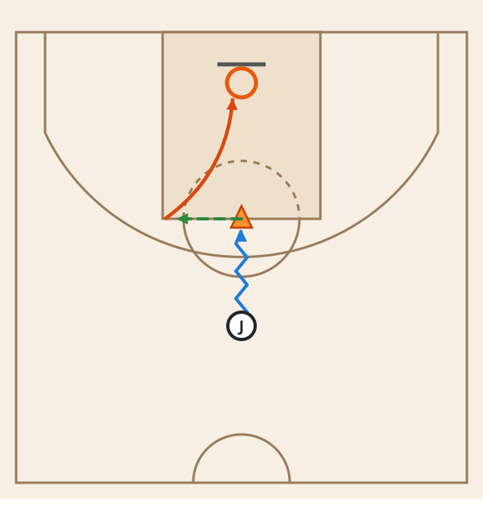
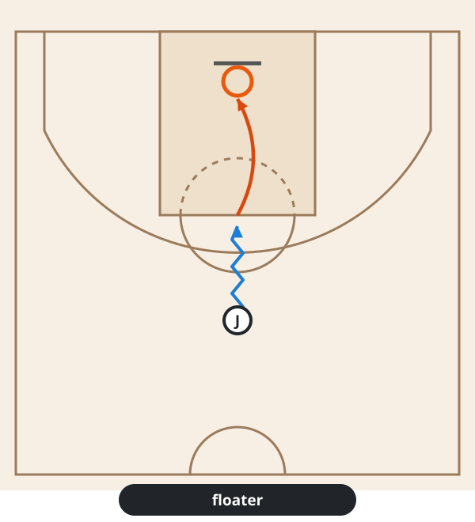
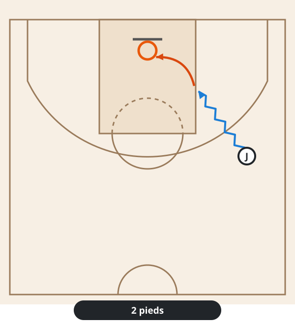
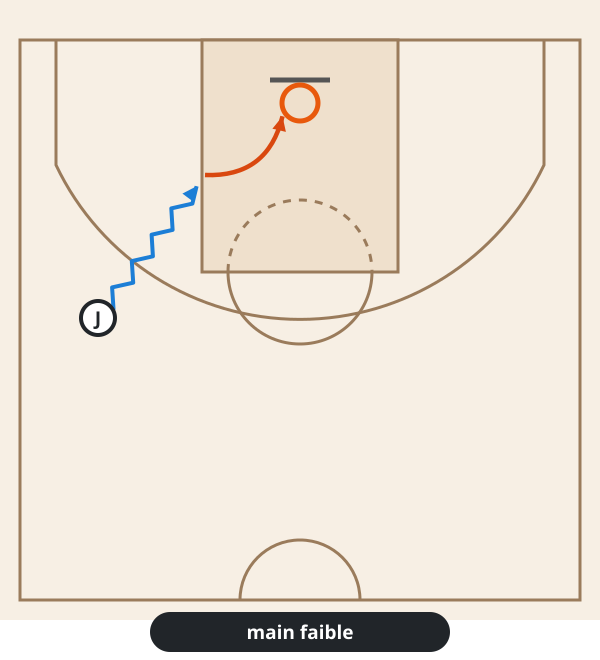
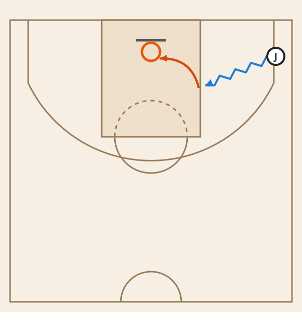
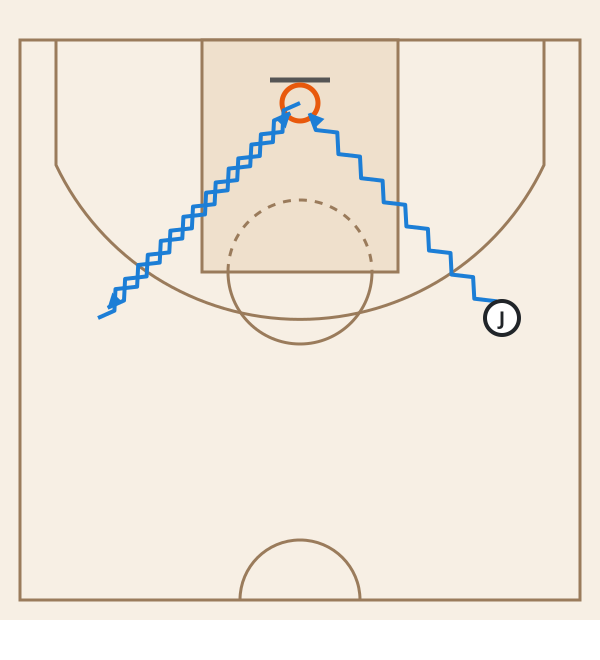
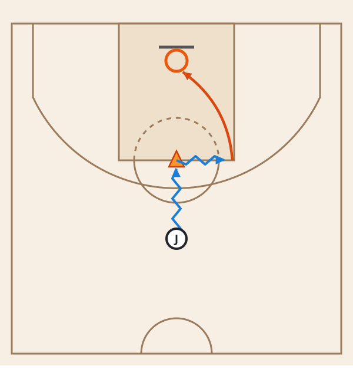

# 5. Finitions près du panier

Les finitions transforment tes pénétrations en points. Travaille des deux côtés, de la main droite et de la main gauche, et en variant les appuis. Utilise la planche : visée du coin supérieur du petit rectangle quand tu arrives en angle.

## F01 · Double pas main droite et main gauche

::: {.exo}

::: {.exo-txt}
**Niveau** ●○○  ·  **Matériel :** Ballon

**Objectif.** Le geste de base de la finition.

**Consigne.** Côté droit : appui droit, appui gauche, saut et pose du ballon main droite contre la planche. Côté gauche : appui gauche, appui droit, main gauche.

**Volume.** 10 par côté

**Pour aller plus loin.** Pars de plus loin avec un dribble, puis deux.

**Erreur fréquente.** Mauvais pied : du côté droit, tu sautes sur le pied gauche.

**Mon meilleur score :** ________  **Date :** ________

**Notes :**

::: {.notes}
 
:::
:::

:::

## F02 · Le « Mikan Drill »

::: {.exo}

::: {.exo-txt}
**Niveau** ●○○  ·  **Matériel :** Ballon

**Objectif.** Finitions rapides des deux mains.

**Consigne.** Sous le panier : tir main droite à droite, rattrape le ballon, pas vers la gauche, tir main gauche. Enchaîne sans dribbler.

**Volume.** 3 × 1 min, compte tes paniers

**Pour aller plus loin.** Version « revers » : tire du côté opposé sous le cercle.

**Erreur fréquente.** Laisser tomber le ballon bas : garde-le au-dessus des épaules.

**Mon meilleur score :** ________  **Date :** ________

**Notes :**

::: {.notes}
 
:::
:::

:::

## F03 · Finition en revers (reverse)

::: {.exo}

::: {.exo-txt}
**Niveau** ●●○  ·  **Matériel :** Ballon

**Objectif.** Finir de l'autre côté du cercle pour se protéger du contre.

**Consigne.** Attaque la ligne de fond côté droit, passe sous le panier et finis main gauche de l'autre côté, en utilisant le cercle comme protection.

**Volume.** 8 par côté

**Pour aller plus loin.** À vitesse match.

**Erreur fréquente.** Passer trop loin du panier : frôle le cercle.

**Mon meilleur score :** ________  **Date :** ________

**Notes :**

::: {.notes}
 
:::
:::

:::

## F04 · Le « pas de l'Euro » (eurostep)

::: {.exo}

::: {.exo-txt}
**Niveau** ●●●  ·  **Matériel :** Ballon, 1 plot

**Objectif.** Éviter un défenseur par un changement de direction pendant le double pas.

**Consigne.** Plot à 2 m du panier. Premier appui à droite du plot, deuxième appui large vers la gauche, finition.

**Volume.** 8 par côté

**Pour aller plus loin.** À vitesse match, finition main faible.

**Erreur fréquente.** Faire trois pas : seulement deux appuis après le dernier dribble.

**Mon meilleur score :** ________  **Date :** ________

**Notes :**

::: {.notes}
 
:::
:::

:::

## F05 · Le tir en suspension sur un pied (floater)

::: {.exo}

::: {.exo-txt}
**Niveau** ●●●  ·  **Matériel :** Ballon

**Objectif.** Finir au-dessus des grands.

**Consigne.** Attaque la raquette, et à 3–4 m du panier, décolle sur un pied et lâche le ballon tôt, haut et doux, d'une main.

**Volume.** 10 par côté

**Pour aller plus loin.** Depuis un départ en dribble rapide.

**Erreur fréquente.** Trajectoire tendue : le ballon doit retomber dans le cercle.

**Mon meilleur score :** ________  **Date :** ________

**Notes :**

::: {.notes}
 
:::
:::

:::

## F06 · Le pas de puissance (power step)

::: {.exo}

::: {.exo-txt}
**Niveau** ●●○  ·  **Matériel :** Ballon

**Objectif.** Finir fort au contact.

**Consigne.** Depuis l'aile, un dribble vers le panier, arrêt en un temps sur les deux pieds, ballon protégé sous le menton, puis montée puissante à deux mains contre la planche.

**Volume.** 8 par côté

**Pour aller plus loin.** Ajoute une feinte de tir avant la montée.

**Erreur fréquente.** Ballon bas au moment de l'arrêt : il serait volé.

**Mon meilleur score :** ________  **Date :** ________

**Notes :**

::: {.notes}
 
:::
:::

:::

## F07 · Finitions main faible uniquement

::: {.exo}

::: {.exo-txt}
**Niveau** ●●○  ·  **Matériel :** Ballon

**Objectif.** Ne plus avoir de « côté faible ».

**Consigne.** Toutes les finitions de la séance avec ta main faible : double pas, revers, Mikan.

**Volume.** 30 finitions

**Pour aller plus loin.** Note ton pourcentage chaque semaine.

**Erreur fréquente.** Revenir à la main forte quand c'est difficile.

**Mon meilleur score :** ________  **Date :** ________

**Notes :**

::: {.notes}
 
:::
:::

:::

## F08 · Le départ de la ligne de fond

::: {.exo}

::: {.exo-txt}
**Niveau** ●●○  ·  **Matériel :** Ballon

**Objectif.** Attaquer par la ligne de fond.

**Consigne.** Depuis le coin, un dribble le long de la ligne de fond, puis finition (double pas ou revers).

**Volume.** 8 par côté

**Pour aller plus loin.** Feinte de tir avant le départ.

**Erreur fréquente.** Sortir des limites : reste près de la ligne sans la toucher.

**Mon meilleur score :** ________  **Date :** ________

**Notes :**

::: {.notes}
 
:::
:::

:::

## F09 · Les 2 minutes de layups

::: {.exo}

::: {.exo-txt}
**Niveau** ●●○  ·  **Matériel :** Ballon, chronomètre

**Objectif.** Finitions en fatigue.

**Consigne.** Pendant 2 minutes : double pas à droite, récupère, dribble jusqu'à la ligne à 3 points, double pas à gauche, et ainsi de suite. Compte tes paniers.

**Volume.** 2 séries, note ton score

**Pour aller plus loin.** Bats ton record chaque semaine.

**Erreur fréquente.** Ralentir dans les derniers 30 s.

**Mon meilleur score :** ________  **Date :** ________

**Notes :**

::: {.notes}
 
:::
:::

:::

## F10 · Finition après un changement de main

::: {.exo}

::: {.exo-txt}
**Niveau** ●●○  ·  **Matériel :** Ballon, 1 plot

**Objectif.** Combiner dribble et finition.

**Consigne.** Plot au niveau du lancer franc. Crossover devant le plot, attaque du côté opposé, double pas.

**Volume.** 8 par côté

**Pour aller plus loin.** Entre les jambes ou dans le dos devant le plot.

**Erreur fréquente.** Changement trop près du plot : commence 1 m avant.

**Mon meilleur score :** ________  **Date :** ________

**Notes :**

::: {.notes}
 
:::
:::

:::
