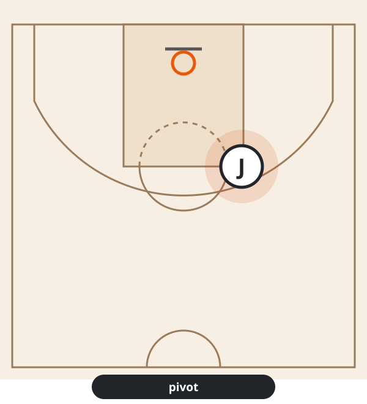
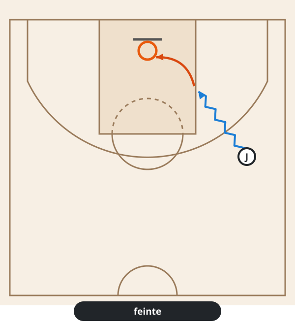
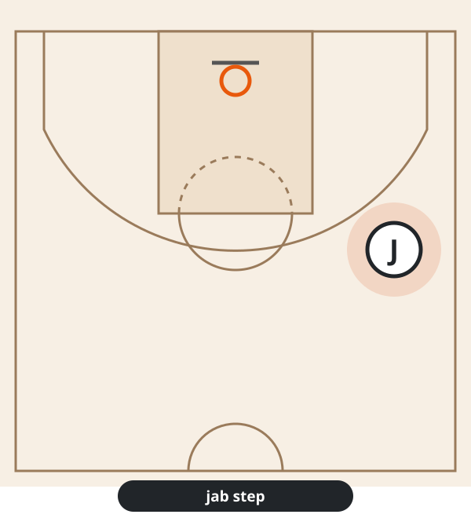
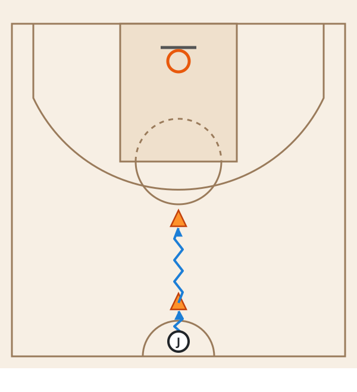
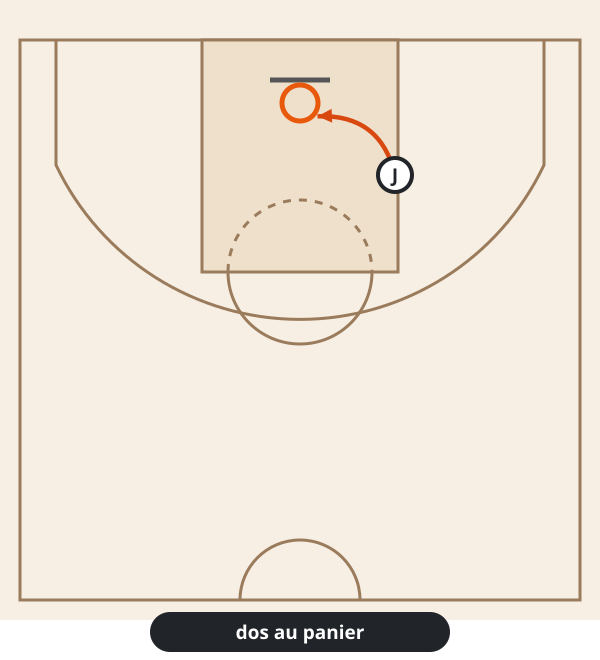
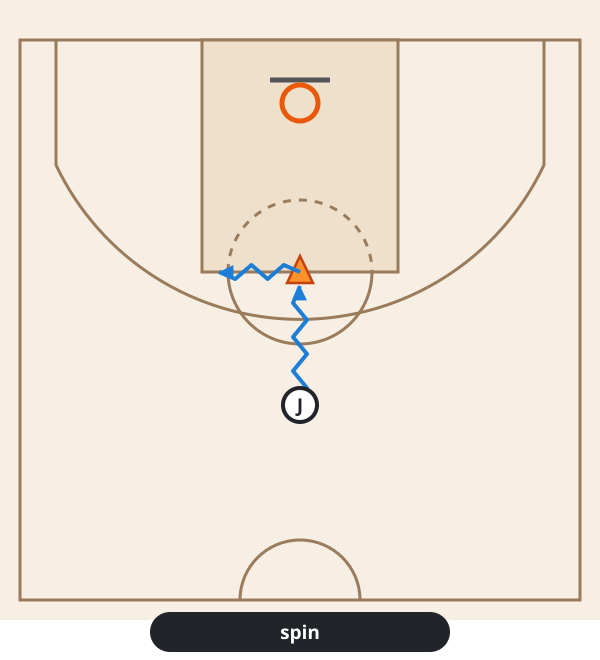
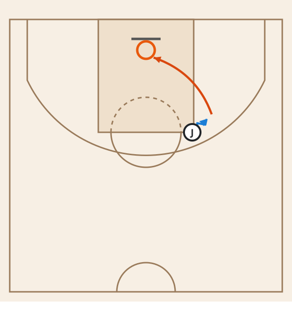

# 6. Jeu de pieds et feintes

Les appuis font la différence entre un bon joueur et un très bon joueur : pied de pivot, arrêts, départs, feintes. Ces exercices sont lents au début : la précision passe avant la vitesse.

## P01 · Le pivot avant et arrière

::: {.exo}

::: {.exo-txt}
**Niveau** ●○○  ·  **Matériel :** Ballon

**Objectif.** Maîtriser le pied de pivot.

**Consigne.** Ballon tenu sous le menton. Garde le pied gauche fixe et tourne autour (pivot avant, puis arrière). Change de pied de pivot.

**Volume.** 3 × 10 par pied

**Pour aller plus loin.** Enchaîne pivot + passe ou pivot + tir.

**Erreur fréquente.** Décoller le pied de pivot : c'est un marcher.

**Mon meilleur score :** ________  **Date :** ________

**Notes :**

::: {.notes}
 
:::
:::

:::

## P02 · La triple menace

::: {.exo}

::: {.exo-txt}
**Niveau** ●○○  ·  **Matériel :** Ballon

**Objectif.** Recevoir prêt à tirer, passer ou dribbler.

**Consigne.** Après chaque réception (passe à soi-même), place-toi fléchi, ballon près de la hanche côté main forte, regard vers le panier. Tiens 2 secondes, puis choisis : tir, dribble ou passe contre un mur.

**Volume.** 20 réceptions

**Pour aller plus loin.** Ajoute une feinte avant chaque choix.

**Erreur fréquente.** Recevoir debout, jambes tendues.

**Mon meilleur score :** ________  **Date :** ________

**Notes :**

::: {.notes}
 
:::
:::

:::

## P03 · Feinte de tir et départ

::: {.exo}

::: {.exo-txt}
**Niveau** ●●○  ·  **Matériel :** Ballon

**Objectif.** Faire décoller le défenseur puis passer.

**Consigne.** En triple menace, feinte de tir crédible (ballon monte, jambes restent fléchies), puis départ en dribble croisé ou direct.

**Volume.** 10 par côté

**Pour aller plus loin.** Feinte + départ + finition.

**Erreur fréquente.** Se redresser pendant la feinte : tu perds ton explosivité.

**Mon meilleur score :** ________  **Date :** ________

**Notes :**

::: {.notes}
 
:::
:::

:::

## P04 · Le départ croisé (jab step)

::: {.exo}

::: {.exo-txt}
**Niveau** ●●○  ·  **Matériel :** Ballon

**Objectif.** Tester le défenseur avec un pas d'appel.

**Consigne.** En triple menace, petit pas vif vers l'avant avec le pied libre, ramène-le, puis tire ou pars en dribble.

**Volume.** 10 par côté

**Pour aller plus loin.** Enchaîne deux jab steps avant le choix.

**Erreur fréquente.** Pas trop grand : tu perds l'équilibre.

**Mon meilleur score :** ________  **Date :** ________

**Notes :**

::: {.notes}
 
:::
:::

:::

## P05 · Les arrêts en un temps et en deux temps

::: {.exo}

::: {.exo-txt}
**Niveau** ●○○  ·  **Matériel :** Ballon

**Objectif.** S'arrêter équilibré et sans marcher.

**Consigne.** Course en dribble, arrêt en un temps (deux pieds en même temps) au plot, puis arrêt en deux temps (droit-gauche) au plot suivant.

**Volume.** 4 longueurs

**Pour aller plus loin.** Arrêt + pivot + tir.

**Erreur fréquente.** Glisser à l'arrêt : abaisse ton centre de gravité.

**Mon meilleur score :** ________  **Date :** ________

**Notes :**

::: {.notes}
 
:::
:::

:::

## P06 · Le « drop step » au poste bas

::: {.exo}

::: {.exo-txt}
**Niveau** ●●○  ·  **Matériel :** Ballon

**Objectif.** Jeu dos au panier.

**Consigne.** Dos au panier sur le bloc, ballon protégé. Pivot arrière en ramenant le pied côté ligne de fond vers le panier, un dribble, finition en puissance.

**Volume.** 8 par côté

**Pour aller plus loin.** Ajoute une feinte vers le centre avant le drop step.

**Erreur fréquente.** Ballon exposé : garde-le serré sous le menton.

**Mon meilleur score :** ________  **Date :** ________

**Notes :**

::: {.notes}
 
:::
:::

:::

## P07 · Le spin (rotation en dribble)

::: {.exo}

::: {.exo-txt}
**Niveau** ●●●  ·  **Matériel :** Ballon, 1 plot

**Objectif.** Changer de direction en tournant.

**Consigne.** Dribble vers le plot, plante le pied avant, tourne en gardant le ballon collé à toi, repars de l'autre côté.

**Volume.** 8 par côté

**Pour aller plus loin.** Spin + finition.

**Erreur fréquente.** Ballon qui s'éloigne pendant la rotation : tire-le vers toi.

**Mon meilleur score :** ________  **Date :** ________

**Notes :**

::: {.notes}
 
:::
:::

:::

## P08 · La séquence feinte-pivot-tir

::: {.exo}

::: {.exo-txt}
**Niveau** ●●●  ·  **Matériel :** Ballon

**Objectif.** Enchaîner les appuis comme en match.

**Consigne.** Réception au coude : feinte de tir, pivot arrière, un dribble, arrêt en un temps, tir.

**Volume.** 6 par côté

**Pour aller plus loin.** Ajoute un deuxième pivot (up and under).

**Erreur fréquente.** Précipiter : chaque étape doit être nette.

**Mon meilleur score :** ________  **Date :** ________

**Notes :**

::: {.notes}
 
:::
:::

:::
