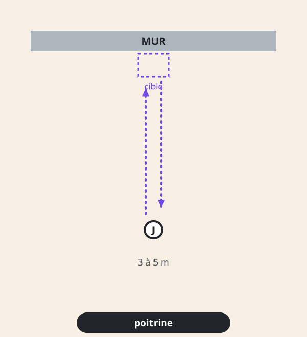
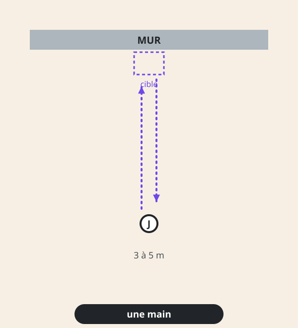
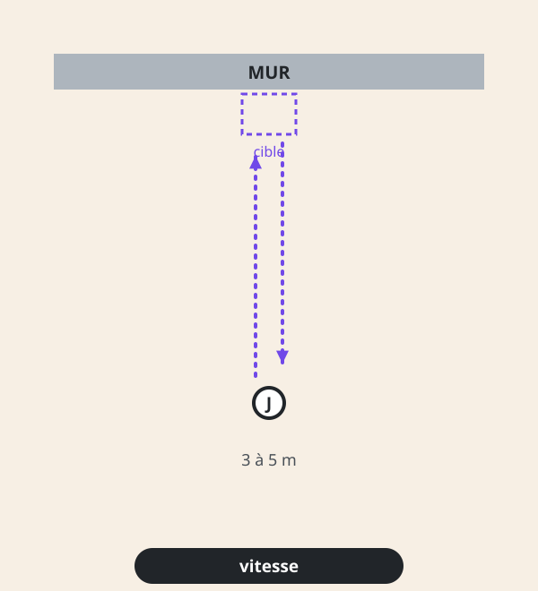

# 7. Passes (contre un mur)

Seul, un mur devient ton coéquipier. Vise un point précis (un carré dessiné à la craie, une brique), passe avec les deux mains puis avec une seule, et récupère le ballon en position de triple menace : prêt à tirer, passer ou dribbler.

## S01 · Passe à deux mains contre le mur

::: {.exo}

::: {.exo-txt}
**Niveau** ●○○  ·  **Matériel :** Ballon, un mur solide

**Objectif.** Passe précise et forte.

**Consigne.** À 3 m du mur, passe à deux mains à hauteur de poitrine vers une cible, pouces vers le bas à la fin du geste. Récupère en triple menace.

**Volume.** 3 × 20

**Pour aller plus loin.** Recule à 4–5 m ; vise une cible plus petite.

**Erreur fréquente.** Passe en cloche : la passe doit être tendue.

**Mon meilleur score :** ________  **Date :** ________

**Notes :**

::: {.notes}
 
:::
:::

:::

## S02 · Passe à une main (main droite, main gauche)

::: {.exo}

::: {.exo-txt}
**Niveau** ●●○  ·  **Matériel :** Ballon, mur

**Objectif.** Passer vite sans changer de main.

**Consigne.** Passe à une main depuis le côté de la hanche, en avançant le pied opposé.

**Volume.** 3 × 15 par main

**Pour aller plus loin.** Après un dribble.

**Erreur fréquente.** Ne jamais utiliser la main faible.

**Mon meilleur score :** ________  **Date :** ________

**Notes :**

::: {.notes}
 
:::
:::

:::

## S03 · Passe à terre (rebond)

::: {.exo}

::: {.exo-txt}
**Niveau** ●○○  ·  **Matériel :** Ballon, mur

**Objectif.** Passer sous les bras d'un défenseur.

**Consigne.** Le ballon doit rebondir aux deux tiers de la distance vers le mur et arriver à hauteur de hanche.

**Volume.** 3 × 15

**Pour aller plus loin.** À une main.

**Erreur fréquente.** Rebond trop près de toi : la passe est lente.

**Mon meilleur score :** ________  **Date :** ________

**Notes :**

::: {.notes}
 
:::
:::

:::

## S04 · Passes rapides en série

::: {.exo}

::: {.exo-txt}
**Niveau** ●●○  ·  **Matériel :** Ballon, mur

**Objectif.** Mains rapides et réception sûre.

**Consigne.** À 2 m du mur, passes à deux mains le plus vite possible pendant 30 s. Compte les passes.

**Volume.** 4 × 30 s

**Pour aller plus loin.** Alterne poitrine et rebond.

**Erreur fréquente.** Réceptions avec les paumes : utilise les doigts.

**Mon meilleur score :** ________  **Date :** ________

**Notes :**

::: {.notes}
 
:::
:::

:::

## S05 · Passe par-dessus la tête

::: {.exo}

::: {.exo-txt}
**Niveau** ●●○  ·  **Matériel :** Ballon, mur

**Objectif.** Passe longue au-dessus d'un défenseur.

**Consigne.** Ballon au-dessus de la tête, coudes légèrement fléchis, passe vers une cible haute, en avançant d'un pas.

**Volume.** 3 × 15

**Pour aller plus loin.** Recule à 6 m.

**Erreur fréquente.** Ramener le ballon derrière la tête : le geste est lent.

**Mon meilleur score :** ________  **Date :** ________

**Notes :**

::: {.notes}
 
:::
:::

:::
