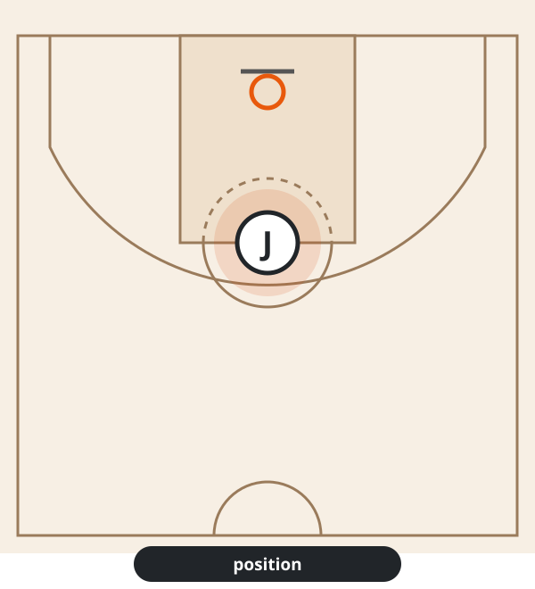
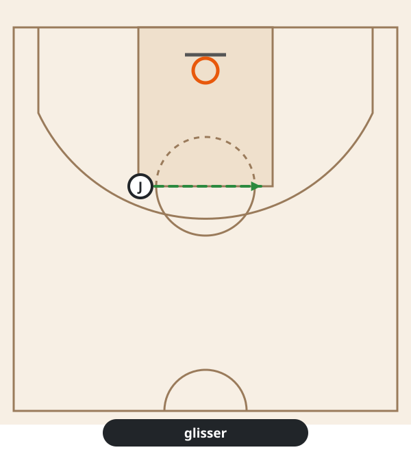
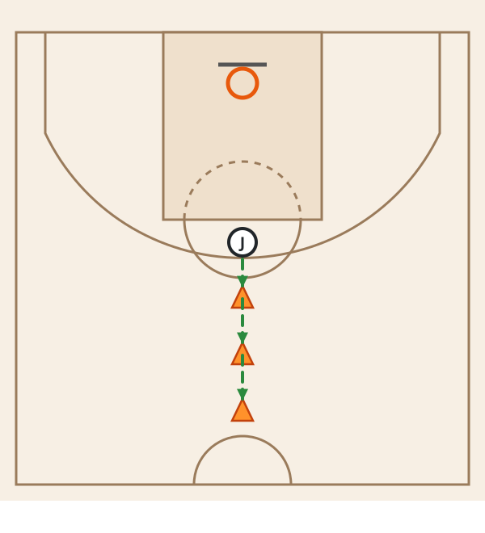
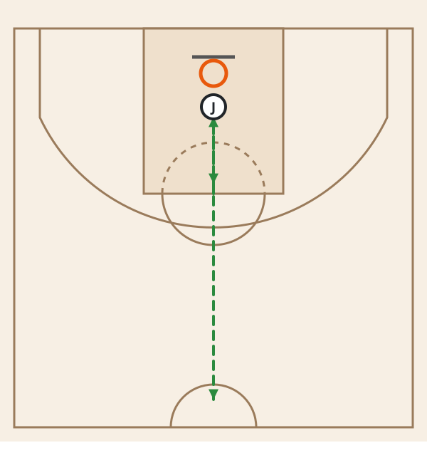
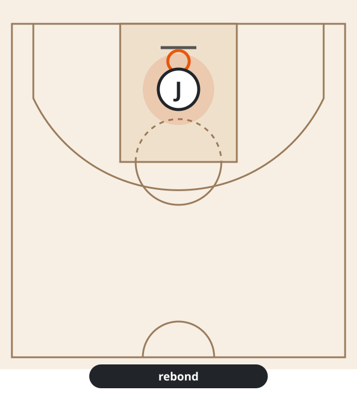
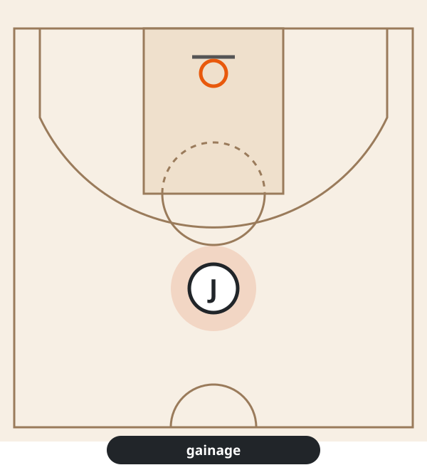
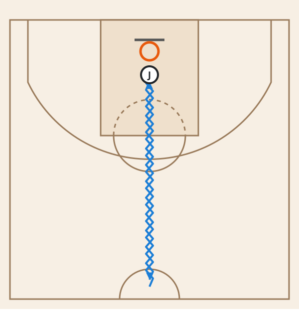

# 8. Défense et condition physique

La défense et la condition se travaillent aussi seul : appuis défensifs, glissements, changements de direction. Ces exercices sont exigeants : respecte les temps de récupération et arrête-toi en cas de douleur.

## C01 · Position défensive tenue

::: {.exo}

::: {.exo-txt}
**Niveau** ●○○  ·  **Matériel :** Aucun

**Objectif.** Construire la position de base.

**Consigne.** Pieds plus larges que les épaules, genoux fléchis, dos droit, mains actives. Tiens la position.

**Volume.** 4 × 30 s, 30 s de repos

**Pour aller plus loin.** Ajoute des petits sautillements sur place.

**Erreur fréquente.** Se pencher en avant : garde le dos droit.

**Mon meilleur score :** ________  **Date :** ________

**Notes :**

::: {.notes}
 
:::
:::

:::

## C02 · Glissements défensifs

::: {.exo}

::: {.exo-txt}
**Niveau** ●○○  ·  **Matériel :** Aucun

**Objectif.** Se déplacer latéralement sans croiser les pieds.

**Consigne.** En position défensive, glisse le long de la ligne de lancer franc d'un côté à l'autre de la raquette, sans croiser les pieds ni te redresser.

**Volume.** 4 × 30 s

**Pour aller plus loin.** Touche la ligne de chaque côté avec la main.

**Erreur fréquente.** Sautiller : les pieds restent proches du sol.

**Mon meilleur score :** ________  **Date :** ________

**Notes :**

::: {.notes}
 
:::
:::

:::

## C03 · Le zigzag défensif

::: {.exo}

::: {.exo-txt}
**Niveau** ●●○  ·  **Matériel :** Plots

**Objectif.** Changer de direction comme face à un dribbleur.

**Consigne.** Recule en glissant en diagonale d'un plot à l'autre en zigzag, sur la moitié du terrain.

**Volume.** 4 passages

**Pour aller plus loin.** Plus vite, plots plus écartés.

**Erreur fréquente.** Tourner le dos au jeu en changeant de direction.

**Mon meilleur score :** ________  **Date :** ________

**Notes :**

::: {.notes}
 
:::
:::

:::

## C04 · Sprints courts (suicides réduits)

::: {.exo}

::: {.exo-txt}
**Niveau** ●●○  ·  **Matériel :** Aucun

**Objectif.** Vitesse et changements de direction.

**Consigne.** Depuis la ligne de fond : sprint jusqu'au lancer franc et retour, jusqu'au milieu et retour.

**Volume.** 4 séries, 1 min de repos

**Pour aller plus loin.** Réduis le repos à 45 s.

**Erreur fréquente.** Freiner tard : abaisse-toi avant de toucher la ligne.

**Mon meilleur score :** ________  **Date :** ________

**Notes :**

::: {.notes}
 
:::
:::

:::

## C05 · Sauts pour le rebond

::: {.exo}

::: {.exo-txt}
**Niveau** ●●○  ·  **Matériel :** Ballon

**Objectif.** Explosivité et timing.

**Consigne.** Lance le ballon contre la planche, saute et attrape-le au point le plus haut, à deux mains, et retombe équilibré.

**Volume.** 3 × 8

**Pour aller plus loin.** Enchaîne avec un tir sans redescendre le ballon.

**Erreur fréquente.** Attraper avec une main : sécurise à deux mains.

**Mon meilleur score :** ________  **Date :** ________

**Notes :**

::: {.notes}
 
:::
:::

:::

## C06 · Gainage du joueur

::: {.exo}

::: {.exo-txt}
**Niveau** ●○○  ·  **Matériel :** Tapis

**Objectif.** Stabilité du tronc pour mieux encaisser les contacts.

**Consigne.** Planche sur les avant-bras, corps aligné. Puis planche latérale de chaque côté.

**Volume.** 3 × 20–30 s chaque

**Pour aller plus loin.** Augmente de 5 s par semaine.

**Erreur fréquente.** Bassin qui tombe : arrête la série plutôt que mal faire.

**Mon meilleur score :** ________  **Date :** ________

**Notes :**

::: {.notes}
 
:::
:::

:::

## C07 · Course navette avec ballon

::: {.exo}

::: {.exo-txt}
**Niveau** ●●○  ·  **Matériel :** Ballon

**Objectif.** Endurance avec dribble.

**Consigne.** Dribble de la ligne de fond à la ligne médiane et retour, main droite à l'aller, main gauche au retour, sans t'arrêter.

**Volume.** 4 × 45 s, 1 min de repos

**Pour aller plus loin.** Termine chaque série par 2 lancers francs.

**Erreur fréquente.** Changer de main au mauvais moment.

**Mon meilleur score :** ________  **Date :** ________

**Notes :**

::: {.notes}
 
:::
:::

:::
